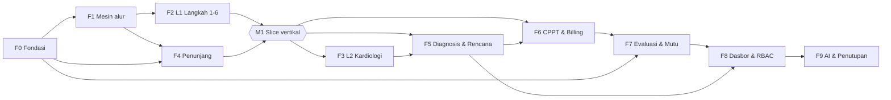

# Plan: Modul RME Poliklinik Spesialis Jantung & Pembuluh Darah (POLI-JANTUNG) — 10 Langkah

| Atribut | Nilai |
|---|---|
| Sumber fungsional | `C:/Users/cubeb/Downloads/Modul_RME_Polispesialis_Jantung_ARIMA_v2.1_Lengkap.docx` (v2.1) |
| Matriks field/opsi/ambang | `docs/plans/2026-11-24-poli-jantung-matriks-spesifikasi.md` (ID `S<n>-L<lapis>-<urut>`, `AMBIGU-01..16`) |
| Inventaris kode eksisting | `docs/plans/2026-11-24-poli-jantung-recon.md` (semua `path:line` kondisi hari ini) |
| Versi dokumen | 1.1 — Draf untuk direview |
| Tanggal | 2026-11-24 |
| Status | **Draf untuk direview** — belum ada kode yang diubah |
| Perubahan 1.1 | ADR-9 (draft JSON, bukan 25 kolom baru); urutan F1.9/F6.1 diperbaiki; milestone M1 slice vertikal; AMBIGU-05 jadi blocking; §13 daftar kerja F0 |
| Tech stack | Django 6.1.2, Python 3.12, SQLite (lokal/uji) / Postgres (produksi), Bootstrap 5 via `templates/base.html`, `manage.py test` (tanpa pytest — `STRAYS.md:8-10`) |

Dokumen ini **tidak** mengulang inventaris. Setiap klaim kondisi kode merujuk recon; setiap klaim field/opsi merujuk matriks.

Penanda artefak: **(baru)** = berkas/tes/route/kolom/fungsi yang **belum ada** di repo dan harus dibuat oleh plan ini; penanda diberikan pada kemunculan pertama, rujukan berikutnya ke artefak yang sama tidak diulang. Tanpa penanda = sudah ada, dan `path:line` merujuk kode nyata hari ini.

---

## 1. Ringkasan keputusan

- **Dibangun:** satu mesin alur asesmen generik (perluasan `IgdAssessmentWorkflow`) + 10 langkah POLI-JANTUNG di atasnya, deep-link dasbor antrean, penunjang 3 tingkat ber-billing, CPPT profesional rajal, dan pemetaan EP lewat lapisan aturan.
- **Dipakai ulang (tanpa kloning):** 5 model alur + `save_step`/`perform_action` + `legacy_workflow_guard` (`pasien/models.py:1443-1510`, `pasien/services/igd_assessment_workflow.py:61-194`, `pasien/services/igd_actions.py:195-246`); katalog penunjang 3 tingkat (`klinis/services/penunjang_catalogue.py:7-42`); stack CPPT profesional + `PembatalanTagihan` (`pasien/services/professional_cppt.py:138-176`, `pasien/professional_care_models.py:22-84`); resolver tarif & sync billing (`klinis/services/tarif.py:6-140`); registry EP (`klinis/services/ep_tindakan.py:1-35`); indikator mutu/PDCA (`akreditasi/risiko_models.py:586-765`).
- **Sengaja tidak dibangun:** model alur kedua, model order kedua, mesin interaksi obat baru tanpa data source, pengenalan tulisan tangan, zoom/pan kanvas anatomi, integrasi biometrik/passkey, endpoint SatuSehat poli baru.
- **Risiko terbesar:** (a) regresi perilaku IGD akibat generalisasi mesin alur; (b) katalog obat kosong + tarif RAJAL tidak ada sehingga Langkah 7–9 tidak dapat menagih (`klinis/services/tarif.py:6-18`); (c) `poliklinik` tanpa FK yang membuat otorisasi/filter poli rapuh (`akreditasi/layanan_unit.py:6-20`).
- **Urutan rilis:** F0 wajib lebih dulu (kode F0.1–F0.8 dan cutover F0.9 sebagai dua rilis berbeda); F1 dapat dirilis gelap di balik flag **tanpa** menutup CPPT/SOAP legacy; setelah F2+F4, gate **M1** (satu episode nyata sampai FINAL + PDF) harus lulus sebelum breadth F3/F5/F6 ditulis; F7–F9 penutup.

---

## 2. Cakupan & non-cakupan

| Cakupan | Keterangan |
|---|---|
| Unit layanan | `POLI-JANTUNG` (`akreditasi/layanan_unit.py:26-27`; `UnitKerja` id 136) |
| Route utama | `/pasien/rajal/?poli=POLI_JANTUNG` (dasbor) + `/pasien/kunjungan/<pk>/asesmen-poli/` (baru) |
| Langkah | 1–10, Lapis 1 dan Lapis 2 sesuai matriks |
| Penunjang | Katalog 3 tingkat + bundle + status 4 nilai + nilai kritis + billing |
| CPPT | Multiprofesi SOAP/ADIME, TTE, verifikasi DPJP ≤ 24 jam |
| Billing | Per penjamin (BPJS vs Umum/Asuransi) untuk tindakan, penunjang, obat |
| Akreditasi | Pemetaan EP via `AturanEpAsesmen`/`AturanEpTindakan`, bukti PDF, indikator PDCA unit |
| AI | Draf Langkah 8/9 (dapat diedit, ber-rujukan) |
| **Non-cakupan** | Pengenalan tulisan tangan→teks; kanvas anatomi zoom/pan; biometrik/passkey; WA jadwal kontrol sebagai fitur baru; SatuSehat encounter poli; aplikasi mobile native; rekam medis unit lain selain POLI-JANTUNG |

---

## 3. ADR

### ADR-1 — Generalisasi mesin alur, bukan fork

**Konteks.** `IgdAssessmentWorkflow` + `IgdVitalObservation` + `IgdAssessmentRevision` + `IgdWorkflowAction` sudah menyediakan versi optimistik, replay `request_id`, revisi append-only, digest tanda tangan, dan guard penulis lama (`pasien/models.py:1443-1510`; `pasien/services/igd_assessment_workflow.py:61-194`; `pasien/services/igd_actions.py:195-246`).

**Keputusan.** Tambah diskriminator `service_line` (`'IGD'` default, `'RAJAL_JANTUNG'` baru) pada `IgdAssessmentWorkflow`; pindahkan `STEPS` (`pasien/forms_igd_workflow.py:12-27`) menjadi registri `STEP_SCHEMAS = {'IGD': ..., 'RAJAL_JANTUNG': ...}`; parameterkan **dua** gerbang tulis yang saat ini mengunci IGD secara hardcoded — `authorize_visit` (`pasien/services/igd_assessment_workflow.py:28-49`) dan `_writable` (`pasien/services/professional_cppt.py:41-43`) — dengan modul + `jenis_kunjungan` + `service_line`; route baru memakai view/service yang sama.

**Alternatif ditolak.** Model `PoliJantungWorkflow` terpisah — menduplikasi tiga mekanisme paling rawan (versi optimistik, replay idempoten, revisi immutable) dan memecah `legacy_workflow_guard`.

**Konsekuensi.** Nama model tetap `Igd*` (warisan historis) — didokumentasikan di docstring, bukan di-rename. Perilaku IGD **tidak boleh berubah satu bita pun**: seluruh suite IGD harus hijau tanpa penyesuaian ekspektasi. `_writable` (`pasien/services/professional_cppt.py:41-43`) saat ini menolak setiap `jenis_kunjungan != 'IGD'`; pelonggarannya terjadi di **F6.1** (menerima `('IGD','RAJAL')` dengan syarat `service_line='RAJAL_JANTUNG'`, status episode belum ditutup `PULANG/RUJUK/MENINGGAL/BATAL`, dan workflow belum `FINAL`), bukan di F1 — lihat ADR-3.

**Cara migrasi.** Migrasi hanya menambah kolom ber-default (`service_line='IGD'`, `schema_key=''`, `draft_payload={}`); baris lama otomatis IGD. Registri skema menjaga `STEPS['IGD']` identik dengan isi sekarang.

### ADR-2 — Satu sumber identitas kunjungan

**Konteks.** `KunjunganPasien.poliklinik` tanpa `choices`, diisi tiga bentuk (label, kode `POLI_*`, teks bebas) — `akreditasi/layanan_unit.py:6-20`; dasbor rajal memfilter `poliklinik__icontains` dan menghitung per poli dengan `label[:15]` (`pasien/views.py:1317,1333`).

**Keputusan.** Otorisasi & filter poli memakai `unit_kerja` + pemetaan `akreditasi/layanan_unit.py` (`POLI_UNIT_CODE`, `visit_unit_code` di `:26-27,166-180`). Hitung antrean per poli memakai kode unit, bukan potongan label.

**Alternatif ditolak.** Menambah logika pencocokan string baru (icontains/alias) — memperbanyak sumber kebenaran yang sudah terbukti tidak konsisten.

**Konsekuensi.** Kunjungan lama yang `unit_kerja` kosong tetap tampil lewat fallback `visit_unit_code`; kunjungan dengan `poliklinik='POLI_JANTUNG'` dan `'Poli Jantung & Pembuluh Darah'` dihitung sama.

**Cara migrasi.** Tanpa migrasi skema. Data lama tidak diubah; hanya jalur baca yang diperbaiki. Backfill opsional (F9) memakai `layanan_unit.resolve_code`.

### ADR-3 — CPPT profesional wajib untuk rajal

**Konteks.** `rajal_soap_simpan` menerima field `subjektif..plan` tetapi template mengirim `soap_s..soap_p` (`pasien/views.py:1512-1520` vs `templates/pasien/rajal_dashboard.html:386-398`); `cppt_tambah` menerima `profesi`/`nama_ppa` bebas (`pasien/views.py:558-570`).

**Keputusan.** Perbaiki bug field SOAP sebagai hotfix F0. Penulis legacy **tidak** ditutup saat F1: penutupan `cppt_tambah`/`rajal_soap_simpan` terjadi di **F6.1**, dalam perubahan yang sama dengan longgarnya `_writable` (`pasien/services/professional_cppt.py:41-43`) — bukan lebih awal. Sejak F6.1, CPPT rajal wajib melalui `create_care_note`/`sign_care_note` (`pasien/services/professional_cppt.py:82-137`).

**Alternatif ditolak.** (a) Membiarkan dua jalur hidup berdampingan permanen — catatan rajal bercabang antara `CPPT.status='LEGACY'` dan `'SIGNED'`, verifikasi DPJP tidak dapat dijamin. (b) Menutup penulis legacy di F1 — episode POLI-JANTUNG kehilangan satu-satunya jalur pencatatan CPPT sampai F6.1 selesai (blackout data).

**Konsekuensi.** Perawat/DPJP harus punya `CPPT` profesional (bukan input bebas) **mulai F6.1**. Bila flag rilis mati, penulis legacy tetap berfungsi. Guard saat ini menutup setiap view ber-`_WORKFLOW_GUARDED_VIEWS` untuk episode ber-workflow (`pasien/services/igd_assessment_workflow.py:181-192`), jadi F1.9 wajib menambahkan pengecualian eksplisit untuk `cppt_tambah`/`rajal_soap_simpan` pada `service_line='RAJAL_JANTUNG'`.

**Cara migrasi.** Tanpa migrasi; guard membaca keberadaan workflow per kunjungan.

### ADR-4 — Billing lewat jalur yang sudah ada

**Konteks.** `order_penunjang_buat` memakai tarif hardcode 150000/250000 (`pasien/views.py:1495-1503`); `order_batch` tidak membuat `BillingItem` sama sekali (`pasien/services/penunjang_orders.py:8-54`); `ItemPenunjang` tidak punya harga (`klinis/expansion_models.py:28-40`); `_kelompok_for` tidak menemukan kelompok untuk RAJAL (`klinis/services/tarif.py:6-18`).

**Keputusan.** Tambah `KelompokLayanan` `POLI_JANTUNG` (unit `POLI-JANTUNG`) + model **baru** `TarifPenunjang` (item, penjamin, nominal, `valid_from`) karena spesifikasi menuntut pembedaan BPJS vs Umum. Order katalog wajib membuat `BillingItem` dengan `sumber='ASESMEN'`; koreksi hanya via `PembatalanTagihan` (`pasien/services/professional_billing.py:35-64`).

> **Amandemen Rilis A2 (2026-11-24).** Bagian "pembedaan BPJS vs Umum" pada ADR ini diganti oleh **ADR-10**: satu nominal per item untuk semua penjamin, penyesuaian per penjamin ditunda sampai tabel tarif resmi ada. Model `TarifPenunjang` dan kewajiban order lewat katalog tetap berlaku.

**Alternatif ditolak.** Harga tunggal di `ItemPenunjang` — tidak dapat memenuhi percabangan penjamin pada Langkah 7/9; tarif hardcode — tidak dapat diaudit.

**Konsekuensi.** Setiap item katalog tanpa baris `TarifPenunjang` untuk penjamin pasien **tidak boleh** menghasilkan tagihan; order tetap boleh dikirim, billing berstatus menunggu (pola `charge_state` PENDING, `pasien/services/professional_billing.py:9-13`). `sumber='ASESMEN'` **tidak cukup** sebagai pembeda: `sync_billing` dan `sync_billing_tindakan` menghapus setiap baris `BillingItem(sumber='ASESMEN')` yang tidak ada di daftar ICD-9 (`klinis/services/tarif.py:90,139`), sehingga baris penunjang ikut tersapu saat tindakan disimpan (`pasien/views.py:2186,2632`). Karena itu sapuan dibatasi ke `kategori='JASA_MEDIS'` (F4.6).

**Cara migrasi.** Migrasi baru `klinis`; seed harga penunjang kardiologi + laboratorium umum dari `klinis/data/master_tarif.py` (perlu keputusan produk, lihat §8).

### ADR-5 — Status order penunjang 4 nilai, nilai kritis dilaporkan

**Konteks.** `OrderPenunjang.STATUS_CHOICES` hanya `ORDERED/PROSES/SELESAI` (`pasien/models.py:1012-1016`); nilai kritis hanya boolean + catatan 200 char (`pasien/models.py:1027-1029`); tidak ada read-back.

**Keputusan.** Perluas `STATUS_CHOICES` menjadi `DRAFT/DIPROSES/SELESAI/BATAL` (dengan migrasi data `ORDERED→DIPROSES`, `PROSES→DIPROSES`), dan tambah field pelaporan nilai kritis: `critical_found_at`, `critical_reported_at`, `critical_reported_to`, `critical_readback_at`, `critical_readback_by`. Jangan membuat model order kedua.

**Alternatif ditolak.** Model `OrderPenunjangKardiologi` — memecah worklist unit (`pasien/services/penunjang_results.py:28-40`) dan snapshot finalisasi.

**Konsekuensi.** `InvestigationResultForm` (`pasien/forms_igd_operations.py:88-101`) harus menolak `SELESAI` tanpa data pelaporan bila `is_critical_value=True`.

**Cara migrasi.** Migrasi `pasien` menambah 5 kolom nullable + `choices` baru; data lama dipetakan, `ORDERED` dianggap `DIPROSES` karena order lama sudah terkirim.

### ADR-6 — Nilai turunan dihitung, bukan disimpan ganda

**Konteks.** MAP/IMT/Brinkman/delta BB tidak ada (`TIDAK DITEMUKAN` di recon §B); NEWS-2 sudah dihitung sebagai properti (`pasien/models.py:653-720`).

**Keputusan.** MAP, kategori MAP, IMT, kategori IMT Asia-Pasifik, Indeks Brinkman, delta BB, dan alert TTV adalah properti/fungsi murni. Snapshot hanya ditulis saat finalisasi ke dalam `revision.snapshot` (`pasien/services/igd_finalization.py:19-39`).

**Alternatif ditolak.** Kolom tersimpan — risiko divergensi bila formula/ambang berubah dan tidak dapat direkonstruksi.

**Konsekuensi.** Perubahan formula berlaku surut untuk tampilan; angka historis tetap terbaca dari snapshot revisi.

**Cara migrasi.** Tanpa kolom turunan. `berat_badan`, `tinggi_badan`, dan input Brinkman (batang/hari, tahun) juga **tidak** menjadi kolom — semuanya kunci `draft_payload` (ADR-9); tidak ada migrasi untuk itu.

### ADR-7 — EP STARKES 2024 hanya lewat lapisan pemetaan

**Konteks.** Katalog aktif masih edisi 2022 (DB `akreditasi_framework`); `AturanEpAsesmen` hanya 4 baris dan `AturanEpTindakan` 17 baris (DB); fixture + cutover 2024 tersedia (`fixtures/standar_akreditasi_2024.json`, `akreditasi/management/commands/starkes_2024_cutover.py:1-30`).

**Keputusan.** Cutover 2024 adalah **prasyarat** yang dieksekusi lebih dulu (F0, di staging + produksi terpisah). Semua pemetaan baru ditulis sebagai baris `AturanEpAsesmen`/`AturanEpTindakan` yang menunjuk `sub_standard`, diselesaikan oleh `klinis/services/ep_tindakan.py:7-35` dan loop di `pasien/views.py:2189-2223`. Tidak ada kode sub-standar 2024 hardcoded di Python.

**Alternatif ditolak.** Menulis kode EP langsung di view/template — akan patah saat katalog berganti dan tidak dapat diaudit.

**Konsekuensi.** Bila cutover belum dijalankan, aturan yang menunjuk sub-standar 2024 akan dibuang senyap oleh resolver (`klinis/services/ep_tindakan.py:29`). Karena itu F0 memblokir F7.

**Cara migrasi.** Command manajemen + data aturan baru; tanpa migrasi skema.

### ADR-8 — Flag rilis terpisah

**Konteks.** `IGD_WORKFLOW_ENABLED` dan `IGD_PROFESSIONAL_CARE_ENABLED` default `false` (`config/settings.py:47-48`).

**Keputusan.** Tambah `POLI_JANTUNG_WORKFLOW_ENABLED` (default `false`) yang menggerbangi route/view/skema POLI-JANTUNG saja. Tidak menumpang flag IGD.

**Alternatif ditolak.** Memakai flag IGD — menyalakan poli jantung akan ikut menyalakan/mematikan IGD dan sebaliknya.

**Konsekuensi.** Dua flag dapat berbeda status; matriks uji harus mencakup 4 kombinasi. Gerbang flag **tidak boleh** memakai `require_rollout()` (`pasien/igd_workflow_views.py:33-35`): fungsi itu hanya memeriksa `IGD_WORKFLOW_ENABLED` ketika workflow belum ada, sehingga episode RAJAL_JANTUNG yang sudah punya workflow akan lolos. Flag baru diperiksa eksplisit di view/service POLI-JANTUNG.

**Cara migrasi.** Satu baris settings + `.env.example`.

### ADR-9 — Draft RAJAL_JANTUNG di JSON, kolom nyata hanya untuk yang di-query

**Konteks.** `IgdAssessmentWorkflow` tidak punya penyimpanan draft sendiri (`pasien/models.py:1443-1456`). Draft IGD hari ini hidup sebagai puluhan kolom di `KunjunganPasien` — seluruh isi `snapshot_visit_fields()` (`pasien/forms_igd_workflow.py:37-39`), mis. `ttv_*`, `anamnesis_*`, `fisik_*`, `skrining_*`, `disposisi_*` (`pasien/models.py:424-560`) — pada tabel yang dibaca setiap render dasbor antrean (`pasien/views.py:1310-1318`). Menambah ~25 kolom kardiologi berarti satu migrasi per perubahan skema langkah dan memperbesar baris yang dipindai dasbor, tanpa manfaat query.

**Keputusan.**
1. `IgdAssessmentWorkflow.draft_payload = JSONField(default=dict, blank=True)` menyimpan nilai langkah RAJAL_JANTUNG.
2. `save_step` (`pasien/services/igd_assessment_workflow.py:61-160`) bercabang pada `service_line`. Jalur IGD tetap byte-identik: `form_for_step` → validasi → `visit.save(update_fields=changed)`. Jalur RAJAL_JANTUNG memvalidasi payload terhadap spesifikasi langkah, menulis `workflow.draft_payload`, lalu menyinkronkan **hanya** kolom yang masuk daftar di bawah.
3. Kolom baru di `KunjunganPasien` dibatasi dua: `red_flag_kardio`, `red_flag_at`.
4. `clinical_snapshot` (`pasien/services/igd_finalization.py:19-39`) menggabungkan `draft_payload` ke dalam snapshot final, sehingga digest tanda tangan mencakup nilai JSON dan revisi tetap dapat direkonstruksi.

**Aturan tetap (berlaku untuk semua fase berikutnya).** Nilai di `draft_payload` **tidak** dapat difilter, diurutkan, di-index, atau diagregasi lewat ORM. Setiap field yang butuh `WHERE`, `ORDER BY`, index, atau agregasi SQL **wajib** kolom nyata di model. Menambah kolom karena itu keputusan sadar ("field ini dipakai indikator/antrean"), bukan default setiap kali spesifikasi menambah input. Promosi field dari JSON ke kolom = satu migrasi kecil + backfill sekali jalan.

**Justifikasi setiap kolom yang dipertahankan.**

| Kolom | Query yang memakainya | Bila dipindah ke JSON |
|---|---|---|
| `red_flag_kardio` | Label banner dirender untuk setiap baris `pasien_rajal_list` (`pasien/views.py:1310-1318`); harus ikut baris tanpa query workflow per pasien | N+1 pada dasbor, atau banner tanpa label |
| `red_flag_at` | Indikator door-to-ECG: `WHERE red_flag_at IS NOT NULL` dalam periode + selisih ke `OrderPenunjang.created_at` (F2.6, F7.7) | Tidak dapat dijadwalkan sebagai agregat; hitungan harus menarik semua workflow ke Python |
| `unit_kerja` (sudah ada, `pasien/models.py:336-342`) | `scope_kunjungan_qs` (`pasien/unit_scope.py:113-116`), `visit_unit_code` (`akreditasi/layanan_unit.py:166-178`) | — (sudah kolom; tidak berubah) |

**Yang dipindah ke JSON meski semula diusulkan kolom.** `alur_awal` dan `kondisi_akhir_rajal` tidak difilter/diagregasi di mana pun hari ini: tidak ada queryset yang menyaring `disposisi_kondisi_akhir` (hanya dibaca template, `templates/pasien/cetak_asesmen_medis_igd.html:180-183`), dan kondisi pulang yang mengikat secara administratif sudah punya kolom sendiri — `DischargeRecord.kondisi_pulang` (`pasien/models.py:951-965`) dengan `KONDISI_PULANG`. Keduanya masuk `draft_payload`; hasil akhir kunjungan tetap terbaca dari `DischargeRecord` + `KunjunganPasien.status`. `berat_badan`/`tinggi_badan` juga JSON: delta BB dibaca dari revisi final terakhir pasien (satu query terindeks lewat `workflow__kunjungan__pasien`, `ORDER BY signed_at LIMIT 1`), bukan dari `WHERE berat_badan`.

**Alternatif ditolak.** (a) Semua field jadi kolom — persis masalah yang ADR ini selesaikan. (b) Semua field jadi JSON termasuk red flag — SLA dan banner jadi tidak dapat diquery. (c) Tabel `PoliJantungDraft` terpisah — join tambahan tanpa manfaat; `IgdAssessmentWorkflow` sudah 1:1 dengan kunjungan (`pasien/models.py:1446`).

**Konsekuensi.** Skema langkah RAJAL_JANTUNG dideklarasikan sebagai spesifikasi `(nama, tipe, pilihan/rentang)`, bukan diturunkan dari model lewat `modelform_factory`; validator langkah menjadi fungsi murni. `STEP_SCHEMAS['IGD']` tetap tuple nama field model sehingga perilaku IGD tidak berubah.

**Cara migrasi.** Satu kolom JSONField ber-default pada `IgdAssessmentWorkflow` (F1) + dua kolom nullable pada `KunjunganPasien` (F2). Tidak ada backfill: belum ada data RAJAL_JANTUNG.

---

### ADR-10 — Satu nominal per item penunjang; penyesuaian per penjamin ditunda

**Menggantikan sebagian ADR-4.** ADR-4 menyebut `TarifPenunjang` dibuat "karena spesifikasi menuntut pembedaan BPJS vs Umum". Keputusan produk Rilis A2 (2026-11-24) menetapkan sebaliknya: **satu nominal per item untuk semua penjamin** sampai tabel tarif resmi per penjamin tersedia.

**Konteks.** Tidak ada tabel tarif resmi per penjamin. `klinis/data/master_tarif.py` memuat `tarif_umum` dan `tarif_bpjs` per prosedur ICD-9, tetapi kolom BPJS dokumen sumber itu tidak dapat diverifikasi sebagai tarif BPJS resmi. `ItemPenunjang` sendiri tidak punya harga maupun pemetaan ICD-9 (`klinis/expansion_models.py:56-94`), sehingga harga per item hanya dapat diturunkan lewat pemetaan eksplisit ke prosedur master.

**Keputusan.**
1. `TarifPenunjang(item, penjamin, nominal, valid_from, valid_to)` tetap ada. Rilis A2 hanya mengisi baris `penjamin='UMUM'` dengan nilai `tarif_umum` master apa adanya. `_resolve_penunjang_price` (`pasien/views.py:1497-1520`) memakai baris penjamin pasien bila ada, lalu jatuh ke nominal UMUM — jadi BPJS dan ASURANSI memakai nominal yang sama tanpa diskon karangan.
2. `KasusTindakan` kelompok `POLI_JANTUNG` disalin apa adanya dari kelompok `JANTUNG`, termasuk kolom `tarif_bpjs` sumber. Tidak ada kolom yang dihapus atau diskon yang dikarang; `resolve()` karena itu masih membedakan BPJS dan UMUM **bila master memang berbeda** (mis. 89.52: 150.000 vs 120.000).
3. Cakupan item dibatasi pada yang prosedurnya punya harga otoritatif: **2 item** — EKG 12-Lead → 89.52 (150.000) dan Echocardiography (USG Jantung) → 88.72 (600.000). **92 item** lain tidak mendapat baris sama sekali.

**Konsekuensi yang dinyatakan terang.** Karena BPJS saat ini **sama dengan** UMUM untuk item penunjang, angka `TarifPenunjang` **belum aman untuk klaim** BPJS; nominal itu hanya aman sebagai tagihan internal/UMUM sampai tabel tarif resmi per penjamin disetujui. Item tanpa baris tetap tidak menagih apa pun: order boleh dikirim, tagihan ditunda dengan pesan "tarif belum ditetapkan" — tidak pernah Rp 0 dan tidak pernah angka karangan.

**Cara migrasi.** Migrasi `klinis/migrations/0007_tarif_penunjang.py` + `python manage.py seed_poli_jantung_tarif` (idempoten). Penyesuaian per penjamin kelak = baris `TarifPenunjang` baru dengan `penjamin` yang sesuai; tidak ada perubahan kode.

---

### ADR-11 — Finalisasi klinis hanya DPJP; penyiapan administratif oleh peran lain

**Konteks.** Spesifikasi 10 langkah menempatkan "verifikasi akhir" di tangan perawat sekaligus menuntut tanda tangan DPJP, dan AMBIGU-05 mencatat kontradiksi itu sebagai penghambat F1. Tanpa keputusan, matriks peran × langkah di F1.10 dan guard `authorize_visit` di F1.4 akan dibangun dua kali. Keputusan produk sudah diambil: **penutupan klinis adalah milik DPJP**, sedangkan langkah penyiapan bersifat administratif dan boleh dikerjakan peran non-DPJP.

**Keputusan.**
1. **Finalisasi klinis hanya DPJP.** Hanya dokter penanggung jawab pelayanan (DPJP) episode yang boleh menutup asesmen klinis, menetapkan kondisi akhir rawat jalan, dan menandatangani resume pulang.
2. **Finalisasi administratif dan langkah penyiapan** (registrasi, triase, pemesanan penunjang, penugasan) milik perawat dan peran non-DPJP sesuai matriks peran × 10 langkah (F1.10).
3. **Perawat tidak boleh menutup langkah klinis; DPJP tidak boleh melompati langkah administratif yang belum lengkap.** Keduanya ditegakkan di server, bukan hanya di template.
4. **Bila episode belum punya DPJP, episode tidak boleh masuk langkah klinis mana pun** — penerusan F0.3.

**Mengapa `require_doctor` tidak cukup.** `require_doctor` (`pasien/services/igd_actions.py:29-31`) hanya memeriksa `user.profile.profesi in {'DOKTER_UMUM','DOKTER_SPESIALIS'}`. Itu menerima **dokter mana pun** — dokter unit lain, dokter tanpa penugasan, dokter yang bukan DPJP episode ini. ADR-11 butir 1 menuntut predikat yang lebih kuat, dan `require_doctor` tetap dipakai apa adanya untuk jalur IGD agar perilakunya tidak bergeser.

**Sumber otoritas yang dipakai: `PenugasanDpjpEpisode`.** Pola yang sudah ada di `verification_authority` (`pasien/services/professional_cppt.py:138-155`) dipakai ulang dalam bentuk ringkas: `pasien/services/poli_rbac.py` memanggil `PenugasanDpjpEpisode` yang `visit=episode`, `unit_id=visit.unit_kerja_id`, `is_active=True`, dan `valid_from <= hari ini <= valid_until`. Kolom teks bebas `KunjunganPasien.dpjp` (`pasien/models.py:334`) **tidak** dipakai sebagai otoritas — ia tidak dapat diverifikasi, tidak punya masa berlaku, dan tidak terikat akun.

**Alternatif ditolak.**
- (a) Memakai `visit.dpjp` (string) sebagai penanda DPJP — satu-satunya jaminan adalah `full_name` yang diketik petugas pendaftaran; tidak mengikat akun, tidak punya masa berlaku, dan tidak dapat diaudit. Ini akan membuat "DPJP-only" hanya sekuat teks bebas.
- (b) Memakai `verification_authority` penuh (PrivilegeSnapshot + mandat `verify_cppt` + penugasan) — memerlukan `Pegawai` HC terverifikasi dan kredensial per unit yang belum tentu ada untuk poli baru; F1 akan gagal di instalasi tanpa data kredensial lengkap. Kredensial tetap wajib untuk **verifikasi CPPT** (F6), bukan untuk menutup asesmen episode.
- (c) Menerima dokter mana pun lewat `require_doctor` — melanggar ADR-11 butir 1.

**Konsekuensi.**
- Episode POLI-JANTUNG wajib punya **tepat satu** penugasan DPJP aktif sebelum langkah apa pun dapat diisi. Penugasan ganda juga ditolak: ambigu berarti tidak ada DPJP yang dapat dipertanggungjawabkan. Penegakan ada di `episode_dpjp()` (`pasien/services/poli_rbac.py`), dipanggil `authorize_visit` untuk setiap penulisan.
- Matriks peran ditegakkan `authorize_step()`/`require_dpjp()` di jalur layanan (`save_step`, `sign`, `finalize`, `addendum`), sehingga penolakan muncul sebagai `PermissionDenied` → HTTP 403, bukan sebagai field `disabled` di template.
- Langkah 8 dan 10 hanya dapat diisi DPJP; langkah 9 (pelaksanaan asuhan) terbuka untuk Farmasi, Gizi, dan Fisioterapi; Kasir/Rekam Medis hanya membaca.
- F6 (verifikasi CPPT ≤24 jam) tetap memakai `verification_authority` penuh — ADR ini tidak melonggarkan syarat kredensial verifikasi, hanya menetapkan siapa yang boleh menutup asesmen.

**Cara migrasi.** Tidak ada migrasi data. Penugasan DPJP per episode dibuat oleh alur penjadwalan/admisi yang sudah ada; episode tanpa penugasan ditolak sejak langkah pertama, bukan setelah asesmen terisi.

---

### ADR-12 — Identitas DPJP: pemilih berbasis akun, `visit.dpjp` hanya tampilan

**Konteks.** ADR-11 menetapkan `PenugasanDpjpEpisode` sebagai satu-satunya sumber otoritas DPJP, tetapi kode hari ini tidak punya jalan dari pilihan DPJP di pendaftaran menuju akun dokter:

* `KunjunganPasien.dpjp` adalah `CharField` bebas (`pasien/models.py:334`) yang diisi dari konstanta `DPJP_CHOICES` (`pasien/models.py:248-273`) — nilai seperti `'dr. Bambang, Sp.JP, FIHA'`.
* `PenugasanDpjpEpisode.doctor` adalah FK ke `AUTH_USER_MODEL` (`pasien/professional_care_models.py:34-60`).
* Tidak ada satu pun fungsi di repo yang memetakan string `DPJP_CHOICES` ke `User`.

**Investigasi (diukur 2026-11-24 pada `db.sqlite3` dev).**

```
>>> UserProfile.objects.filter(profesi__in=['DOKTER_SPESIALIS','DOKTER_UMUM','DOKTER_GIGI']).count()
0                       # 29 akun total, 0 berprofesi dokter
>>> Pegawai.objects.exclude(akun=None).count()
2                       # 'Pegawai Smoke' -> akun 21, 'Siska Lestari, S.Kep., Ners' -> akun 50
>>> set(nama DPJP_CHOICES) & set(Pegawai.nama_lengkap)
set()                   # 0 irisan; 6 dokter Sp.JP di Pegawai (Bima Sakti, Cynthia, Dimas, Hendra, Ratna, Wahyu)
                        # tidak satu pun bernama Faisal/Bambang seperti di DPJP_CHOICES
```

Jadi **tidak ada** akun dokter, dan **tidak ada** join `sdm.Pegawai` yang menghubungkan orang nyata ke akun untuk dokter. `Pegawai.akun` ada (`sdm/models/pegawai.py:28-34`) tetapi kosong untuk seluruh tenaga medis, dan nama di HC pun tidak cocok dengan `DPJP_CHOICES`.

**Keputusan.** Opsi (b): pemilih DPJP berbasis akun.

1. `pasien/services/poli_dpjp.py` (**baru**) adalah satu-satunya penulis penugasan DPJP. `eligible_dpjp_accounts()` mengembalikan akun `User` aktif yang `profile.profesi ∈ {DOKTER_UMUM, DOKTER_SPESIALIS, DOKTER_GIGI}` — bukan konstanta teks.
2. **Sumber kebenaran otoritas = `PenugasanDpjpEpisode` aktif.** `KunjunganPasien.dpjp` adalah string tampilan yang **diturunkan**: `assign_dpjp()`/`clear_dpjp()` menulisnya, dan `reconcile_dpjp_display()` memulihkannya dari penugasan bila ada penulisan lama yang membuatnya menyimpang. Kolom itu tidak pernah dibaca sebagai otoritas (`poli_rbac.episode_dpjp`).
3. **String tanpa akun bukan penugasan.** Jalur lama yang hanya mengirim teks (`dpjp`, `dpjp_igd_baru`, `dpjp_igd_lama`) tetap berjalan apa adanya dan tetap tidak membuat penugasan — perilaku IGD tidak berubah satu bita pun. Konsekuensinya eksplisit: episode dengan DPJP teks tetapi tanpa akun tetap ditolak pada langkah klinis pertama (ADR-11 butir 4).
4. **Otoritas penetapan** = administrasi unit, bukan klinisi: `SUPER_ADMIN`, `ADMIN_RS`, atau `KEPALA_UNIT` yang `unit_kerja`-nya **sama persis** dengan unit episode. Perawat, farmasi, gizi, fisioterapi, kasir, dan dokter non-DPJP ditolak 403. Dokter tidak boleh menetapkan dirinya sendiri — sudah ditegakkan `PenugasanDpjpEpisode.clean()`.
5. **Masa berlaku.** `valid_until` wajib (non-null) tetapi tidak ada kebijakan produk untuknya. Dipakai `DEFAULT_ASSIGNMENT_DAYS = 30` dari `valid_from` sebagai jaring pengaman operasional; penggantian DPJP tidak mengandalkan tanggal ini karena penugasan lama dinonaktifkan eksplisit. Angka ini konstanta modul, bukan aturan klinis.
6. **Idempoten.** Menetapkan ulang dokter yang sama pada penugasan aktif yang masih berlaku tidak membuat baris baru dan tidak menaikkan versi apa pun.

**Alternatif ditolak.**
- (a) Tabel pemetaan string→akun — menambah lapisan kedua di atas `UserProfile.profesi` yang sudah menyatakan profesi; pemetaan akan basi setiap ada dokter baru, dan tetap butuh akun yang belum ada.
- Membuat akun dokter dari nama `DPJP_CHOICES` — mengarang orang. `DPJP_CHOICES` tidak cocok dengan `sdm.Pegawai` mana pun, jadi akun hasil karangan tidak akan pernah bisa login oleh dokter nyata.

**Konsekuensi yang dinyatakan terang.**
- Di instalasi hari ini pemilih DPJP **kosong** karena 0 akun dokter. Formulir menampilkan sebabnya ("belum ada akun dokter terdaftar") dan tidak menawarkan teks bebas sebagai pengganti. Registrasi tetap berjalan; episode hanya tidak punya DPJP berotoritas sampai ops membuat akun dokter dan menetapkannya. Ini konsekuensi yang benar, bukan cacat: ADR-11 menuntut otoritas yang bisa login.
- Pembuatan akun dokter adalah tugas operasional (menu Pengguna), **bukan** migrasi data dan bukan seed. Repo ini tidak boleh mengarang nama dokter.
- `DPJP_CHOICES`/`DPJP_POLI_MAP` **tidak dihapus**: keduanya masih dipakai formulir lama dan `tests_pendaftaran_integrasi.py`. Keduanya kini berstatus katalog tampilan untuk unit yang belum punya akun dokter, dan tidak lagi menjadi sumber otoritas. Bila kelak seluruh unit punya akun dokter, keduanya dapat dihapus bersama formulir lamanya.
- Biaya yang dinilai jujur: mengganti pemilih teks menjadi pemilih akun menuntut kolom `dpjp_user` di `kunjungan_form.html`, di `pendaftaran_route`, dan di `igd_kunjungan_edit`. Karena `DPJP_POLI_MAP` memetakan poli→nama dokter (bukan poli→akun), penyaringan "DPJP poli ini" berbasis akun belum dapat dilakukan tanpa data akun; pemilih karena itu menampilkan seluruh akun dokter, dan penyaringan per unit memakai `profile.unit_kerja` bila ada.

**Cara migrasi.** Tanpa migrasi skema. `PenugasanDpjpEpisode` sudah ada; yang ditambahkan hanya penulis tunggalnya di jalur layanan.

---

### ADR-13 — Ambang F2: mana yang dari sumber, mana yang diwarisi kode

**Konteks.** F2 menuntut `imt_kategori`, `map_kategori`, dan `ttv_alerts`. Sebagian ambangnya berangka eksplisit di sumber, sebagian tidak. Mencampur keduanya tanpa catatan membuat angka karangan terlihat sama otoritatifnya dengan angka yang dikutip.

**Keputusan — tiga kelas ambang, dinyatakan terpisah di kode.**

1. **Berangka pada sumber (dikutip apa adanya).** Takikardia >100, bradikardia <50, hipoksia SpO2 <92, krisis hipertensi ≥180/120, hipotensi sistole <90, nyeri NRS ≥4, IMT Asia-Pasifik (<18,5 / 18,5–22,9 / 23–24,9 / 25–29,9 / ≥30), door-to-ECG ≤10 menit.
2. **Tidak berangka pada sumber, tetapi sudah berlaku di kode (diwarisi, bukan dikarang).** Grade Morse (≥45 TINGGI, ≥25 SEDANG — `pasien/forms_igd_workflow.py` sebelum F2) dan ambang MST "berisiko" (skor ≥2 — dipakai tiga template: `_asesmen_awal_wizard.html:213`, `igd_dashboard.html:1714`, `kunjungan_detail.html:232`). Keduanya dipindah menjadi konstanta bernama (`MORSE_WEIGHTS`, `MORSE_TINGGI_MIN`, `MORSE_SEDANG_MIN`, `MST_CHOICES`, `MST_BERISIKO_MIN`) **tanpa mengubah nilainya**, sehingga form IGD dan jalur rajal tidak dapat berbeda pendapat.
3. **Tidak berangka pada sumber dan belum ada di kode — sengaja TIDAK diterapkan.** Ambang alert RR dan suhu: sumber menyatakan "tidak ada ambang alert yang ditetapkan" (S4-L1-04, S4-L1-06). `ttv_alerts()` tidak memuatnya, dan tes menegaskan hal itu.

**Batas normal vs hipertensi (AMBIGU-01) — keputusan yang perlu ditinjau.** Sumber hanya memberi empat kategori: normal, hipertensi derajat 1–2, krisis, hipotensi. Karena hanya ada empat, batas normal→HT harus satu angka. Kode memakai **normal <140/90, hipertensi ≥140/90** (ambang JNC-7 untuk derajat 1). Rekomendasi §8 plan ("normal <120/80, HT-1 140–159/90–99") **tidak dapat dipakai apa adanya**: rentang 120–139/80–89 tidak punya kategori pada daftar empat nilai sumber, sehingga kategori akan kosong untuk pasien yang jelas tidak normal. Bila Komite Medis menghendaki pembagian 120–139 sebagai kategori tersendiri, yang berubah adalah daftar kategori (menjadi lima) — bukan sekadar konstanta — dan itu keputusan produk, bukan penyetelan.

**Konsekuensi.** `map_kategori()` mengembalikan `NORMAL`/`HIPERTENSI`/`KRISIS`/`HIPOTENSI`; tidak ada kategori "prehipertensi" yang tidak ada di sumber. `mst_score()` mengembalikan `(skor, berisiko)` dan **tidak** menyimpan kategori baru di model — kolom `skrining_gizi_mst` tetap hanya menyimpan angka, seperti sebelum F2.

**Cara migrasi.** Tanpa migrasi. Seluruh nilai turunan dihitung (ADR-6); tidak ada kolom baru selain `red_flag_*`.

---

## 4. Delta model data

| Model | Field/Relasi baru | Tipe | Default | Alasan | Fase |
|---|---|---|---|---|---|
| `IgdAssessmentWorkflow` | `service_line` | CharField(20), choices `IGD`/`RAJAL_JANTUNG` | `'IGD'` | ADR-1 diskriminator | F1 |
| `IgdAssessmentWorkflow` | `schema_key` | CharField(40), blank | `''` | versi skema langkah per service_line | F1 |
| `IgdAssessmentWorkflow` | `draft_payload` | JSONField(dict) | `{}` | ADR-9: seluruh nilai langkah RAJAL_JANTUNG | F1 |
| `KunjunganPasien` | `red_flag_kardio` | CharField(40), blank | `''` | banner antrean, dibaca per baris tanpa join (S2-L1-02) | F2 |
| `KunjunganPasien` | `red_flag_at` | DateTimeField, null, `db_index` | `NULL` | SLA door-to-ECG diagregasi lintas kunjungan (S2-L1-03) | F2 |
| `OrderPenunjang` | `status` choices diperluas | CharField(15) | `DIPROSES` | ADR-5 | F4 |
| `OrderPenunjang` | `interpretasi` | TextField, blank | `''` | hasil klinis terpisah dari status (S7-L1) | F4 |
| `OrderPenunjang` | `lvef` | PositiveSmallInteger, null | `NULL` | TTE (S7-L1-02) | F4 |
| `OrderPenunjang` | `critical_found_at` | DateTimeField, null | `NULL` | jam temuan | F4 |
| `OrderPenunjang` | `critical_reported_at` | DateTimeField, null | `NULL` | jam lapor DPJP | F4 |
| `OrderPenunjang` | `critical_reported_to` | CharField(150), blank | `''` | penerima laporan | F4 |
| `OrderPenunjang` | `critical_readback_at` | DateTimeField, null | `NULL` | read-back | F4 |
| `OrderPenunjang` | `critical_readback_by` | FK User, null, PROTECT | `NULL` | verifikator read-back | F4 |
| `OrderPenunjang` | `billing_item` | OneToOne `BillingItem`, null, PROTECT | `NULL` | tautan tagihan order | F4 |
| `ItemPenunjang` | *(tidak berubah)* | — | — | harga dipindah ke `TarifPenunjang` | F0 |
| `TarifPenunjang` (**baru**) | `item`, `penjamin`, `nominal`, `valid_from`, `valid_to` | FK/Char/Decimal/Date | — | tarif per penjamin (ADR-4) | F0 |
| `KelompokLayanan` | baris data `POLI_JANTUNG` | — | — | dasar `_kelompok_for` untuk rajal | F0 |
| `ResepElektronik` | *(tidak berubah)* — `RAWAT_JALAN` sudah ada di `JENIS_RESEP` (`pasien/models.py:1058-1063`) | — | — | hanya jalur pembuatannya yang dibuka (F5.3) | F5 |
| `CPPT` | `verifikasi_due_at` | DateTimeField, null | `NULL` | batas verifikasi DPJP; diisi `sign_care_note` = waktu sign + 24 jam | F6 |
| `CPPT` | `ttd_image` | FileField/CharField, blank | `''` | gambar tanda tangan TTE (F6.4) | F6 |

Semua entri pada kolom "Field/Relasi baru" adalah field **baru**; tidak ada field lama yang di-rename atau diubah tipenya. Baris `ItemPenunjang` sengaja tidak berubah (harga pindah ke `TarifPenunjang`).

**Field yang tinggal di `draft_payload` (kunci JSON, bukan kolom).** Daftar ini menggantikan ~25 baris kolom pada versi 1.0; tidak satu pun punya query, index, atau agregat.

| Langkah | Kunci JSON (tipe) | Rujukan |
|---|---|---|
| 1 | `jenis_kunjungan_poli`, `asal_rujukan`, `status_rujukan` (str) — DPJP & penjamin memakai kolom yang sudah ada (`dpjp`, `penjamin`) | S1-L1-05, S1-L2-01..02 |
| 2 | `mobilitas_datang` (str; beda sumbu dari kolom `cara_datang` yang berisi SENDIRI/RUJUKAN/AMBULANS/POLISI, `pasien/models.py:484-489`), `onset_gejala`, `pemicu_gejala`, `alur_awal` (str) | S2-L1-01, S2-L1-04, S2-L2-01..02 |
| 3 | `keluhan_utama_kardio`, `nyeri_karakteristik_kardio`, `nyeri_penjalaran`, `status_merokok`, `rokok_batang_per_hari`, `rokok_tahun`, `status_kehamilan`, `kepatuhan_obat` (str/int), `riwayat_jantung`, `faktor_risiko_kardio`, `obat_rutin` (list) | S3-L1-01..03, S3-L2-01..05 |
| 4 | `berat_badan`, `tinggi_badan` (str desimal) — TTV tetap `IgdVitalObservation` | S4-L2-01 |
| 5 | `dukungan_sosial` (str) | S5-L2-02 |
| 6 | `fisik_kardio` (dict: iktus, BJ, murmur derajat/lokasi, gallop, ronki, JVP, edema, CRT) | S6-L1/L2 |
| 8 | `klasifikasi_fungsional`, `rencana_tindak_lanjut` (str), `edukasi_kardio` (list) | S8-L1-04..05, S8-L2-02 |
| 10 | `kondisi_akhir_rajal`, `respons_terapi_rajal`, `insiden_rajal` (str), `ttv_pulang_sistole/diastole/nadi` (int) | S10-L1-02..04, S10-L2-01 |

`ttv_pulang_*` boleh JSON karena TTV sudah punya jalur sendiri: `save_step` menulis `IgdVitalObservation` ber-`phase='EVALUATION'` (`pasien/services/igd_assessment_workflow.py:141-147`), dan itu sudah tabel terpisah yang tidak membebani `KunjunganPasien`.

Migrasi usulan (semua **baru**): `pasien/migrations/0039_workflow_service_line_and_draft.py` (F1: `service_line`, `schema_key`, `draft_payload`), `pasien/migrations/0040_rajal_red_flag.py` (F2: dua kolom), `pasien/migrations/0041_order_status_and_critical_reporting.py` (F4), `pasien/migrations/0042_cppt_verification_due_and_ttd.py` (F6), `klinis/migrations/0007_tarif_penunjang.py` (F0). Migrasi F7 (`0043_rajal_evaluation_fields.py`) **hilang**: Langkah 10 hanya menulis JSON + `DischargeRecord` yang sudah ada. Migrasi F2/F3 menyusut dari ~25 kolom menjadi 2.

Konsekuensi operasional ADR-9: `draft_payload` tidak dapat difilter ORM. Bila kelak sebuah indikator butuh `WHERE`/agregat atas kunci JSON, kunci itu dipromosikan menjadi kolom lewat migrasi kecil — bukan dibaca dengan memuat semua workflow ke Python.

Catatan SLA verifikasi: `VerifikasiCppt` adalah `ImmutableCareRecord` yang dibuat **saat verifikasi terjadi** (`pasien/professional_care_models.py:63-71`; `pasien/services/professional_cppt.py:159-176`), sehingga tidak boleh menyimpan batas waktu. Batas disimpan di `CPPT.verifikasi_due_at`; status kepatuhan **dihitung** (`verifikasi_due_at` vs `VerifikasiCppt.performed_at`) dan tidak disimpan sebagai kolom.

---

## 5. Rencana kerja per fase

### F0 — Fondasi & prasyarat (blocking, tanpa modul baru)

Tujuan: menutup cacat produksi dan menyiapkan data/tarif/flag yang dibutuhkan semua fase berikutnya.
Prasyarat: tidak ada. Boleh dirilis mandiri.

Daftar kerja lengkap, terurut, beserta perintah pembuktian per item ada di **§13**. Urutannya: (a) F0.10 baseline lebih dulu, (b) perbaikan produksi F0.1–F0.5 dalam satu rilis tanpa keputusan produk, (c) fondasi data/flag F0.6–F0.8, lalu (d) cutover STARKES F0.9 sebagai rilis **terpisah** — rollback-nya mengganti katalog, bukan kode, sehingga tidak boleh menumpang rilis yang sama.

### F1 — Mesin alur generik + kerangka 10 langkah

Tujuan: POLI-JANTUNG punya alur berversi, ber-guard, ber-finalisasi, dengan navigasi 10 langkah — tanpa satu pun field kardiologi baru.
Prasyarat: F0.6, F0.10.

| # | Langkah | Berkas | Bukti |
|---|---|---|---|
| F1.1 | Tambah `service_line` + `schema_key` + `draft_payload`; migrasi ber-default | `pasien/models.py:1443-1456`, migrasi 0039 | Migrasi naik bersih; baris lama `service_line='IGD'`, `draft_payload={}`; `manage.py test pasien.tests_igd_workflow_*` tetap hijau |
| F1.2 | Pindahkan `STEPS` ke `STEP_SCHEMAS` dengan entri `IGD` identik byte-per-byte | `pasien/forms_igd_workflow.py:12-27` → registri baru | Test pembanding: `STEP_SCHEMAS['IGD'] == STEPS_LAMA` (snapshot literal) |
| F1.3 | Tambah entri `RAJAL_JANTUNG` 10 langkah sebagai spesifikasi `(nama, kind, pilihan/rentang)`, bukan field model | registri skema | Test: kunci di luar spesifikasi ditolak (`WorkflowValidation`); nilai di luar pilihan ditolak |
| F1.4 | Parameterkan `authorize_visit` (modul `igd`/`rajal`, `jenis_kunjungan`, unit `POLI-JANTUNG`) | `pasien/services/igd_assessment_workflow.py:28-49` | Kunjungan RAJAL unit lain → 403; RAJAL `POLI-JANTUNG` + profesi klinis → 200 |
| F1.5 | `get_visit`/`save_step` memilih skema dari `service_line`; jalur RAJAL menulis `draft_payload` tanpa menyentuh kolom `KunjunganPasien` (sinkron `red_flag_*` baru ada di F2 setelah kolomnya lahir) | `pasien/services/igd_assessment_workflow.py:50-160` | Simpan langkah 1 lalu langkah 2 → `version` 1 lalu 2, `draft_payload` berisi kunci langkah; jalur IGD tetap menulis kolom model; versi basi → `WorkflowConflict` (409) |
| F1.6 | Route `/kunjungan/<pk>/asesmen-poli/` + `?step=` + draft JSON, memakai view/service yang sama | route **baru** di `pasien/urls.py`, `pasien/igd_workflow_views.py:41-230` | GET step 1..10 → 200; step 11 → 400; POST draft → JSON `version` naik |
| F1.7 | Template navigasi kiri 10 langkah + panel evaluasi kanan (versi/waktu), mode baca saat FINAL | `templates/pasien/poli_workflow.html` (**baru**), `static/js/poli-workflow.js` (**baru**) | Browser QA: 10 tautan bernomor, `aria-current` pindah sesuai `?step=`; FINAL → semua field `disabled` |
| F1.8 | Finalisasi + kunci + addendum lewat `perform_action` (`sign`/`finalize`/`addendum`) | `pasien/services/igd_finalization.py:41-190` | Finalisasi → `status='FINAL'`, `IgdAssessmentRevision` v1; addendum → v2 tanpa mengubah v1; simpan draft setelah FINAL → 409 |
| F1.9 | Tutup **hanya** `order_penunjang_buat` untuk episode RAJAL_JANTUNG ber-workflow; `cppt_tambah` dan `rajal_soap_simpan` **tetap terbuka** sampai F6.1 (butuh pengecualian eksplisit — guard menutup semua anggota daftar, `:181-192`) | `pasien/urls.py:150-161`, `pasien/services/igd_assessment_workflow.py:181-192` | (a) episode ber-workflow: `order_penunjang_buat` → 409; (b) **gate rilis**: episode POLI-JANTUNG ber-workflow masih dapat menulis CPPT lewat `cppt_tambah` dan SOAP lewat `rajal_soap_simpan` (200/302, 1 baris `CPPT`), dan order penunjang lewat jalur baru F4.1/F4.6; (c) episode tanpa workflow → semua jalur lama tetap jalan |
| F1.10 | RBAC per peran (6 peran × 10 langkah, ADR-11): perawat isi 1–7 & 9, DPJP penuh + verifikasi, farmasi/gizi/fisioterapi langkah 9 (gizi juga 5), kasir baca saja; DPJP-only untuk `sign`/`finalize`/`addendum` | `pasien/services/poli_rbac.py` (**baru**), `pasien/services/igd_assessment_workflow.py:28-49` | `pasien/tests_poli_rbac.py`: tiap peran × tiap langkah diuji HTTP (403 vs 200), dokter non-DPJP ditolak pada `sign`/`finalize`, episode tanpa DPJP tidak dapat mengisi langkah mana pun |
| F1.11 | Idempotensi: replay `request_id` sama mengembalikan hasil identik | `pasien/services/igd_actions.py:219-224` | Kirim aksi 2× dengan `request_id` sama → `replayed=True`, `IgdWorkflowAction` tetap 1 baris |

### F2 — Langkah 1–6 Lapis 1 + nilai turunan + red flag

Tujuan: perawat/DPJP dapat menyelesaikan triage cepat kardiologi dengan alert otomatis.
Prasyarat: F1.7, F1.9.

| # | Langkah | Berkas | Bukti |
|---|---|---|---|
| F2.1 | Field L1 Langkah 1–6 (identitas terkunci, jenis kunjungan klinis, penjamin, keluhan utama, cara datang) | spesifikasi skema langkah → `draft_payload`; migrasi 0040 hanya untuk `red_flag_*` | POST step 1 → kunci tersimpan di `draft_payload`; field identitas `disabled`; `KunjunganPasien` tidak bertambah kolom selain `red_flag_*` |
| F2.2 | `berat_badan`/`tinggi_badan` di `draft_payload` + fungsi murni `imt(berat, tinggi)` dan `imt_kategori` (Asia-Pasifik: <18,5 / 18,5–22,9 / 23–24,9 / 25–29,9 / ≥30) | fungsi **baru** di `pasien/models.py`, pola `hitung_news_score` (`:660-720`) | Unit test: 58 kg/160 cm → 22,66 "Normal"; 70/160 → 27,34 "Obesitas I"; delta BB dari revisi final terakhir |
| F2.3 | Properti `map_value` = (S + 2D)/3 + `map_kategori` (normal/HT-1-2/krisis ≥180/120/hipotensi S<90) | `pasien/models.py` (turunan dari `ttv_sistole`/`ttv_diastole` yang sudah ada) | 118/74 → 88,7; 185/125 → "krisis"; 85/55 → "hipotensi" |
| F2.4 | Alert TTV: takikardia >100, bradikardia <50, hipoksia SpO2 <92, suhu, RR — fungsi tunggal `ttv_alerts()` | fungsi **baru** di `pasien/models.py` | Test ambang batas tepi (100 vs 101, 92 vs 91) |
| F2.5 | Red flag → kolom `red_flag_kardio` + `red_flag_at`; `alur_awal` → `draft_payload`; banner merah + tombol transfer IGD | `pasien/models.py` (2 kolom, migrasi 0040), `templates/pasien/poli_workflow.html` | Pilih "Nyeri Dada Khas Angina" → `red_flag_at` terisi + `red_flag_kardio` berlabel, banner tampil, tombol menuju `pasien:igd_dashboard`; `alur_awal` terbaca dari payload |
| F2.6 | Indikator door-to-ECG ≤10 menit: hitung selisih `red_flag_at` → `OrderPenunjang.created_at` (jenis EKG) | properti baru + template | Order EKG 7 menit setelah red flag → badge "PATUH"; 14 menit → "TERLAMBAT" |
| F2.7 | Skrining jatuh (Morse) & gizi (MST) memakai validasi yang sudah ada, tampil ringkas di L1 | `pasien/forms_igd_workflow.py:107-127` | Skor Morse 45 → "TINGGI"; MST 3 → berisiko + rekomendasi dietisien |

### F3 — Langkah 3–6 Lapis 2 kardiologi

Tujuan: kedalaman klinis kardiologi tanpa mengubah struktur alur.
Prasyarat: F2, M1.

| # | Langkah | Berkas | Bukti |
|---|---|---|---|
| F3.1 | Riwayat jantung multi-select + faktor risiko + onset/pemicu/penjalaran nyeri | skema langkah → `draft_payload` | POST step 3 → kunci JSON tersimpan; nilai di luar pilihan ditolak |
| F3.2 | Status merokok + batang/hari + tahun → fungsi murni `indeks_brinkman` | skema langkah (`draft_payload`) + fungsi **baru** di `pasien/models.py` | 20 batang × 15 tahun → 300 (berat); 5 × 4 → 20 (ringan) |
| F3.3 | Status kehamilan/menyusui + peringatan kontraindikasi (ACEi/ARB/ARNI/statin/warfarin) | skema langkah, `pasien/services/medication_safety.py:21-62` | Pasien hamil + resep Ramipril → finding **baru** `PREGNANCY_CONTRA` memblokir kirim |
| F3.4 | Rekonsiliasi obat rutin (kepatuhan + daftar obat) | skema langkah → `draft_payload` | POST → kunci `obat_rutin`/`kepatuhan_obat` terisi; tampil di panel kanan CPPT |
| F3.5 | Fisik kardio terstruktur (iktus kordis, BJ/murmur derajat+lokasi, gallop, ronki/wheezing, JVP, edema, CRT) di kunci `fisik_kardio` | skema langkah → `draft_payload`, `templates/pasien/poli_workflow.html` | Pilih murmur 2/6 apeks → tersimpan sebagai dict; render ulang menampilkan pilihan sama |
| F3.6 | Penanda anatomi memakai validasi yang sudah ada (maks 100, koordinat 0–1) | `pasien/forms_igd_workflow.py:91-99` | 101 marker → error; marker di luar 0..1 → error |
| F3.7 | Biopsikososial/spiritual + dukungan sosial terstruktur | skema langkah → `draft_payload` | POST → kunci `dukungan_sosial` tersimpan; kosong → tidak wajib |

### F4 — Langkah 7 penunjang

Tujuan: order 3 tingkat dari UI, status 4 nilai, nilai kritis ber-read-back, billing otomatis.
Prasyarat: F0.8, F0.9, F1.9. Tidak menunggu F3 (indikasi order cukup dari L1 + diagnosis yang sudah ada), sehingga boleh berjalan paralel dengan F2 setelah F1.

| # | Langkah | Berkas | Bukti |
|---|---|---|---|
| F4.1 | Dropdown kaskade 1→2→3 memakai endpoint katalog yang sudah ada | `pasien/pharmacy_views.py:39-46`, `klinis/services/penunjang_catalogue.py:44-70` | Pilih level 1 → 200 daftar level 2; pilih level 3 → daftar item aktif saja |
| F4.2 | Status 4 nilai + migrasi data | `pasien/models.py:1012-1016`, migrasi 0041 | Order lama `ORDERED` → `DIPROSES`; transisi `DIPROSES→SELESAI` sah, `SELESAI→DIPROSES` ditolak |
| F4.3 | Interpretasi klinis + LVEF terpisah dari status | `pasien/models.py`, `pasien/forms_igd_operations.py:88-101` | Status `SELESAI` + interpretasi kosong → error validasi; LVEF 35 + interpretasi "HFrEF" tersimpan |
| F4.4 | Nilai kritis: jam temuan, jam lapor, penerima, read-back, verifikator; wajib bila `is_critical_value` | `pasien/models.py`, `pasien/services/penunjang_results.py:42-79` | Simpan kritis tanpa `critical_reported_at` → ditolak; lengkap → tersimpan + badge di dasbor |
| F4.5 | SLA lapor ≤30 menit: properti `critical_sla_menit` + status PATUH/TERLAMBAT | `pasien/models.py` | 12 menit → PATUH; 41 menit → TERLAMBAT |
| F4.6 | Billing otomatis dari order katalog (`sumber='ASESMEN'`, `kode_icd`/item, tautan `billing_item`). **Wajib**: batasi sapuan hapus di `sync_billing` dan `sync_billing_tindakan` ke `kategori='JASA_MEDIS'` — keduanya menghapus **semua** `BillingItem(sumber='ASESMEN')` yang tidak ada di daftar ICD-9 (`klinis/services/tarif.py:90,139`), sehingga baris penunjang akan terhapus setiap kali tindakan disinkronkan (`pasien/views.py:2186,2632`) | `pasien/services/penunjang_orders.py:8-54`, `klinis/services/tarif.py:62-139` | Order 2 item → 2 `BillingItem`; kirim ulang batch sama → tidak duplikat; **lalu** panggil `sync_billing(k, ['89.52'])` → 2 baris penunjang tetap ada |
| F4.7 | Quick-order bundle (Nyeri Dada Akut, Evaluasi Gagal Jantung, Kontrol HT/Dislipidemia) sebagai daftar item katalog, bukan model baru | data seed + `penunjang_orders.py` | Pilih bundle → N order terkirim dengan `batch_id` sama; jumlah = isi bundle |
| F4.8 | Worklist unit pelaksana menampilkan status 4 nilai + kolom read-back | `templates/pasien/laboratorium_dashboard.html`, `pasien/ancillary_views.py` | Unit LAB melihat order POLI-JANTUNG; unit lain tidak |

### F5 — Langkah 8 diagnosis & rencana

Tujuan: DPJP menetapkan diagnosis, stratifikasi, rencana, resep GDMT, edukasi, kontrol.
Prasyarat: F0.7, F4, F3, M1.

| # | Langkah | Berkas | Bukti |
|---|---|---|---|
| F5.1 | ICD-10 primer/sekunder lewat `DiagnosisKunjungan` + katalog yang ada | `pasien/models.py:1422-1433`, `pasien/igd_workflow_views.py:310-344` | Set primer 2× → hanya 1 aktif primer (constraint DB); sekunder tersimpan |
| F5.2 | Klasifikasi fungsional NYHA/CCS + stratifikasi risiko + rencana tindak lanjut | skema langkah → `draft_payload` | Nilai tersimpan di payload; pilihan di luar daftar ditolak |
| F5.3 | Jalur resep RAJAL: `resep_buat` tidak lagi mengalihkan ke IGD untuk episode RAJAL ber-workflow | `pasien/views.py:700-709`, `pasien/services/prescriptions.py:197-274` | POST resep RAJAL → `ResepElektronik(jenis_resep='RAWAT_JALAN')`, status `DIKIRIM`; tanpa depo → error jelas |
| F5.4 | GDMT shortcut mengisi baris draf resep yang sama (bukan baris ganda) | `static/js/poli-prescription.js` (**baru**), `pasien/services/prescriptions.py` | Pilih regimen lalu tambah manual obat sama → tetap 1 baris, dosis diperbarui |
| F5.5 | Edukasi terstruktur + ekspor PDF bukti bertanda tangan | `templates/pasien/cetak_edukasi_kardio.html` (**baru**), `pasien/pdf_utils.py` | GET PDF → `application/pdf`, memuat checklist + nama penanda tangan + timestamp |
| F5.6 | Jadwal kontrol → e-SKDP otomatis (nomor SKDP) | `pasien/models.py:950-992`, `pasien/views.py:1541-1601` | Simpan kontrol 30 hari → `DischargeRecord.skdp_nomor` terisi format `SKDP-YYYYMMDD-NNNN` |
| F5.7 | Toolbar metode input (Manual/Master/AI) seragam untuk step 8 & 9 | `templates/pasien/_poli_input_toolbar.html` (**baru**) | Ketiga mode menghasilkan provenance `diagnosis_mode`/`sumber_data` yang berbeda |

### F6 — Langkah 9 CPPT multiprofesi & billing

Tujuan: CPPT rajal lewat jalur profesional, TTE, verifikasi 24 jam, tindakan poli ber-tarif.
Prasyarat: F3, F5, M1.

| # | Langkah | Berkas | Bukti |
|---|---|---|---|
| F6.1 | Penulis CPPT profesional untuk rajal (`cppt_create/save/sign`): longgarkan `_writable` agar menerima `jenis_kunjungan='RAJAL'` **hanya bila** `workflow.service_line='RAJAL_JANTUNG'` dan episode belum ditutup. **Dalam perubahan yang sama**: cabut pengecualian F1.9, lalu tutup `cppt_tambah` dan `rajal_soap_simpan` (tambahkan `rajal_soap_simpan` ke `_WORKFLOW_GUARDED_VIEWS`) | `pasien/services/professional_cppt.py:41-43` (`_writable`), `:82-137` (create/save/sign), `pasien/urls.py:150-161`, `pasien/services/igd_assessment_workflow.py:181-192` | CPPT rajal ber-workflow → `status='DRAFT'`; RAJAL tanpa workflow → tetap ditolak; episode `PULANG`/`FINAL` → ditolak; `cppt_tambah`/`rajal_soap_simpan` → 409 **hanya setelah** item ini (sebelumnya 200, lihat gate F1.9); suite IGD `pasien.tests_professional_cppt` tetap hijau |
| F6.2 | Komponen O otomatis: TTV/MAP terbaru, ringkasan penunjang, viewer bertanda | `pasien/services/professional_presentation.py`, template | Buka CPPT → O memuat MAP terhitung & 3 hasil penunjang terakhir; bukan input manual |
| F6.3 | Quick-chips keluhan + kepatuhan terhubung daftar obat aktif | template + JSON `structured_content` | Klik 3 chip → S terisi; tandai obat tidak patuh → tersimpan per obat |
| F6.4 | TTE: kanvas tanda tangan + konfirmasi kredensial (bukan PIN/biometrik) | model lampiran/field baru `ttd_image`, `pasien/services/professional_cppt.py:120-125` | Sign tanpa gambar → error; dengan gambar + konfirmasi → `SIGNED` + hash tersimpan |
| F6.5 | Verifikasi DPJP ≤24 jam: `sign_care_note` mengisi `CPPT.verifikasi_due_at` = waktu sign + 24 jam; status TERLAMBAT **dihitung** dari `verifikasi_due_at` vs `VerifikasiCppt.performed_at`, bukan disimpan | `pasien/models.py:845-895` (`CPPT`), `pasien/services/professional_cppt.py:120-125` (`sign_care_note`), `pasien/professional_care_models.py:63-71` (`performed_at`) | Sign 10:00 → `CPPT.verifikasi_due_at` = 10:00 hari berikutnya; verifikasi 09:00 besok → status "TEPAT"; 11:00 besok → status "TERLAMBAT" dari perhitungan; tidak ada kolom status baru di DB |
| F6.6 | Tindakan poli ICD-9-CM + tarif per penjamin + EP otomatis | `pasien/asesmen_tindakan.py`, `klinis/services/ep_tindakan.py:7-35` | Tambah 89.52 → `BillingItem` nominal BPJS/UMUM sesuai penjamin; EP terisi dari `AturanEpTindakan` |
| F6.7 | Void tagihan beralasan (tanpa hapus) | `pasien/services/professional_billing.py:35-64` | Void → `is_void=True` + `PembatalanTagihan` 1 baris; delete langsung → ditolak |
| F6.8 | Panel kanan: regulasi, consent, brosur, multi-upload | `templates/pasien/_poli_right_panel.html` (**baru**), `pasien/services/igd_attachments.py:73-103` | Upload PDF → hash cocok; upload `.exe` → ditolak; 3 file tampil dengan nama asli |

### F7 — Langkah 10 evaluasi akhir, disposisi, mutu

Tujuan: menutup kunjungan dengan kondisi akhir, disposisi 4 cabang, dan bukti mutu.
Prasyarat: F6, F0.9.

| # | Langkah | Berkas | Bukti |
|---|---|---|---|
| F7.1 | Kondisi akhir + respons terapi rajal + TTV pulang (3 parameter) ke `draft_payload`; kondisi pulang yang mengikat ditulis ke `DischargeRecord.kondisi_pulang` yang sudah ada | skema langkah → `draft_payload`, `pasien/models.py:951-965` | Simpan → kunci payload terisi **dan** `DischargeRecord.kondisi_pulang` terisi; TTV pulang tampil di resume; tidak ada kolom baru di `KunjunganPasien` |
| F7.2 | Disposisi 4 cabang dengan berkas berbeda (pulang / ranap / rujuk antar-poli / rujuk keluar) | `pasien/views.py:1541-1601`, `pasien/services/igd_finalization.py:93-152` | Tiap cabang → status & berkas benar; ranap tanpa bed → error |
| F7.3 | Panel versi/waktu + finalisasi terkunci + addendum | `templates/pasien/poli_workflow.html`, `pasien/services/igd_finalization.py:155-190` | Setelah final: simpan draft 409, addendum 200 dengan revisi baru |
| F7.4 | Insiden/risiko unit dari Langkah 10 → `InsidenKeselamatan` | `akreditasi/risiko_models.py:530-583` | Pilih KTD → 1 baris `InsidenKeselamatan(unit=POLI-JANTUNG, jenis='KTD')` |
| F7.5 | Aturan EP asesmen & tindakan untuk poli jantung (data, bukan kode) | `klinis/models.py:208-245`, seed | Asesmen lengkap → `KorelasiEpAsesmen` TERPENUHI untuk sub-standar aturan; snapshot final memuatnya |
| F7.6 | Ekspor PDF bukti EP per kunjungan | `templates/pasien/cetak_bukti_ep.html` (**baru**), `pasien/pdf_utils.py` | GET PDF → memuat kode EP + status + catatan + timestamp verifikator |
| F7.7 | Umpan ke indikator PDCA unit (waktu tunggu, kelengkapan asesmen, lapor nilai kritis) | `akreditasi/risiko_models.py:586-641,743-765`, `akreditasi/mutu_laporan.py` | `CatatanIndikator` unit bertambah setelah 1 kunjungan selesai; angka = hitungan manual |

### F8 — Integrasi dasbor antrean & RBAC

Tujuan: 5 tombol dasbor menjadi deep-link bermakna + indikator keselamatan + panel longitudinal.
Prasyarat: F1, F7.

| # | Langkah | Berkas | Bukti |
|---|---|---|---|
| F8.1 | Deep-link: Pendaftaran Baru→L1, SOAP→L2 atau L8/9 (aturan kelengkapan), Penunjang→L7, Disposisi→L10, Detail→panel pratinjau | `templates/pasien/rajal_dashboard.html:305-361`, `pasien/views.py:1308-1368` | Klik tiap tombol → URL `asesmen-poli/?step=N` sesuai aturan; tanpa JS tetap benar |
| F8.2 | Aturan "asesmen terisi" untuk tombol SOAP (definisi eksplisit: langkah 1–6 wajib minimal terisi) | service baru `poli_completeness()` | Langkah 1–6 kosong → step 2; lengkap → step 8; teruji 2 arah |
| F8.3 | Sticky kolom identitas + ikon alergi/nilai kritis belum dibaca | `templates/pasien/rajal_dashboard.html` | CSS `position:sticky` aktif; pasien alergi → ikon; order kritis tanpa read-back → ikon |
| F8.4 | Panel pratinjau longitudinal: tren TTV/LVEF, GDMT aktif, riwayat kunjungan | view + template baru | Pasien 2 kunjungan → grafik/daftar 2 titik; obat aktif = resep terakhir `SELESAI` |
| F8.5 | Matriks RBAC final per peran (sesuai tabel F spesifikasi + AMBIGU-05) | `pasien/services/igd_assessment_workflow.py:28-49`, dokumen | 6 akun × 10 langkah matriks akses lulus uji otomatis |

### F9 — AI & penutupan

Tujuan: draf AI Langkah 8/9, migrasi kunjungan lama, QA end-to-end, dokumentasi operator.
Prasyarat: F5, F8.

| # | Langkah | Berkas | Bukti |
|---|---|---|---|
| F9.1 | Endpoint draf AI poli jantung memakai `_call_deepseek` + sanitasi + audit | `akreditasi/ai_service.py:105-190`, `klinis/services/ai_igd.py:14-50` (pola) | Respons `success=False` saat `ai_enabled=False`; setiap panggilan → 1 `AuditLog` |
| F9.2 | Rate limit + tiket kandidat (draf tidak bisa diselundupkan tanpa persetujuan) | `akreditasi/security_utils.py` rate_limit, pola `pasien/igd_workflow_views.py:281-304` | 6 panggilan/menit → 429; kode di luar tiket → ditolak saat simpan |
| F9.3 | Draf AI muncul sebagai teks yang dapat diedit + rujukan sumber (langkah asal) | template + JSON provenance | Terima draf → `diagnosis_mode='AI'` + `provenance` memuat langkah sumber |
| F9.4 | Migrasi kunjungan lama: backfill `unit_kerja`/`poliklinik` dari `layanan_unit.resolve_code` | `pasien/management/commands/backfill_kunjungan_unit.py` (**baru**) | Dry-run melaporkan N kunjungan tak terpetakan; apply idempoten |
| F9.5 | QA end-to-end HTTP + browser | `qa/runner.py:1-20`, `qa/clinical_expansion_browser.py:1-10` | Skrip browser: 1 pasien POLI-JANTUNG menempuh 10 langkah sampai final + PDF; 0 `pageerror` |
| F9.6 | Dokumentasi operator (alur, SLA, eskalasi) | dokumen **baru** di `docs/` | Dokumen ditinjau Kepala Unit |

---

## 6. Matriks traceability

| Langkah | Field (rujuk ID matriks) | Model tujuan | Fase | Uji penerimaan |
|---|---|---|---|---|
| 1 | S1-L1-01..07, S1-L2-01..03 | `Pasien`, `UnitKerja`, `KunjunganPasien` (`dpjp`, `penjamin`, `unit_kerja`), `draft_payload` (L2) | F0, F2 | Nomor kunjungan & DPJP tervalidasi; identitas read-only |
| 2 | S2-L1-01..04, S2-L2-01..02 | `KunjunganPasien` (`red_flag_kardio`, `red_flag_at`), `draft_payload` (`alur_awal`, `onset_gejala`, `pemicu_gejala`) | F2, F3 | Red flag → timestamp + banner + door-to-ECG |
| 3 | S3-L1-01..03, S3-L2-01..06 | `draft_payload` (riwayat/faktor/rokok/obat), `AlergiPasienTerstruktur` | F2, F3 | Brinkman terhitung; alergi memblokir resep |
| 4 | S4-L1-01..04, S4-L2-01..04 | `KunjunganPasien` (`ttv_*` existing), `IgdVitalObservation`, `draft_payload` (BB/TB) | F2 | MAP/IMT + kategori + alert tepi |
| 5 | S5-L1-01..03, S5-L2-01..03 | `KunjunganPasien` (`skrining_*`, `status_psikososial` existing), `draft_payload` (`dukungan_sosial`) | F2, F3 | Morse/MST menurunkan grade; intervensi tampil |
| 6 | S6-L1-01..05, S6-L2-01..04 | `draft_payload` (`fisik_kardio`), `KunjunganPasien.penanda_anatomi` | F3 | Fisik kardio tersimpan & render ulang konsisten |
| 7 | S7-L1-01..03, S7-L2 katalog | `OrderPenunjang`, `TarifPenunjang`, `BillingItem`, `ItemPenunjang` | F0, F4 | Status 4 nilai; kritis ber-read-back; billing per penjamin |
| 8 | S8-L1-01..04, S8-L2-01..04 | `DiagnosisKunjungan`, `ResepElektronik`/`ResepDetail`, `draft_payload` (NYHA/CCS, edukasi), `DischargeRecord` | F5 | Resep RAJAL terkirim; SKDP terbit; PDF edukasi |
| 9 | S9-L1 CPPT, S9-L2 tindakan/billing | `CPPT` (`verifikasi_due_at`, `ttd_image`), `CpptRevision`, `VerifikasiCppt`, `TindakanAsesmen`, `BillingItem`, `PembatalanTagihan` | F6 | CPPT rajal tersimpan hanya bila `service_line='RAJAL_JANTUNG'`; `verifikasi_due_at` terisi saat sign; status kepatuhan terhitung; void tanpa hapus |
| 10 | S10-L1-01..05, S10-L2-01..03 | `draft_payload` (kondisi/respons/insiden/TTV pulang), `DischargeRecord`, `KorelasiEpAsesmen`, `InsidenKeselamatan`, `QualityRecord` | F7 | Final terkunci; EP + PDF bukti; indikator bertambah |

`draft_payload` pada kolom "Model tujuan" berarti nilai tinggal di `IgdAssessmentWorkflow.draft_payload` (ADR-9) dan **tidak** dapat difilter/diagregasi ORM. Kolom `KunjunganPasien` yang disebut tanpa `draft_payload` sudah ada hari ini dan tidak berubah tipenya.

---

## 7. Urutan & ketergantungan



Cabang paralel yang sah: **F4 ∥ F2** setelah F1 (F4 hanya butuh F0.8/F0.9 + guard F1.9); **F8 ∥ F7** sebagian (deep-link tombol bisa dikerjakan setelah F1, panel longitudinal setelah F5).

### M1 — Slice vertikal (gate sebelum breadth)

**Definisi selesai.** Satu pasien POLI-JANTUNG nyata menempuh Langkah 1–4 → 7 → 10 sampai `FINAL` dan menghasilkan PDF, memakai F1 (mesin) + F2 (L1) + F4 (penunjang) saja. Langkah 5, 6, 8, 9 boleh masih kosong/legacy.

**Kenapa sebelum F3/F5/F6.** Semua mekanisme paling rawan — percabangan `save_step`, `draft_payload`, guard penulis lama, finalisasi + snapshot + digest, dan billing penunjang — baru terbukti utuh ketika satu episode benar-benar ditutup. Menulis F3/F5/F6 lebih dulu berarti menggandakan permukaan yang harus diperbaiki bila salah satu mekanisme itu keliru. Slice ini juga menguji gate F1.9 secara nyata: selama M1, CPPT dan SOAP **masih lewat jalur legacy** dan harus tetap berhasil.

**Bukti.** Lihat §11 baris M1.

---

## 8. Keputusan produk yang masih terbuka

| Kode | Pertanyaan | Rekomendasi default | Pemilik keputusan | Dampak bila salah |
|---|---|---|---|---|
| AMBIGU-01 | Batas "normal" dan "HT derajat 1–2" untuk MAP/kategori TD tidak berangka | Pakai JNC/PERHI: normal <120/80, HT-1 140–159/90–99, HT-2 ≥160/100; krisis ≥180/120 | Komite Medis / KSM Jantung | Kategori salah → alert palsu/hilang; indikator mutu tidak dapat diaudit |
| AMBIGU-02 | "Troponin meningkat bermakna" & "ST-elevasi akut" tanpa ambang | Troponin di atas URL laboratorium (per-analit); STE ≥1 mm di 2 sadapan berurutan (kecuali V2–V3) | Komite Medis + Lab | Nilai kritis tidak konsisten antar-shift |
| AMBIGU-03 | Rumus Indeks Brinkman tidak ditulis | IB = batang/hari × tahun; ringan <200, sedang 200–599, berat ≥600 | Komite Medis | Klasifikasi merokok salah |
| AMBIGU-04 | Set status TTE tanpa "Dibatalkan", label tak sejajar EKG | Samakan 4 status untuk EKG & TTE (ADR-5) | Kepala Unit | Order batal tak tercatat → billing menggantung |
| **AMBIGU-05** — **BLOCKING F1** | Perawat disebut pada "verifikasi akhir" tetapi RBAC tak memberi hak: apakah Perawat Poli boleh memfinalisasi/memverifikasi, atau finalisasi hanya DPJP? | Perawat: isi 1–6 + CPPT keperawatan; finalisasi hanya DPJP; Kepala Unit boleh finalisasi administratif | Kepala Unit + Komite Keperawatan | Menentukan bentuk guard `authorize_visit` dan matriks peran × 10 langkah. Salah di sini = menulis ulang guard + seluruh uji akses di F1 dan F8.5 |
| AMBIGU-06 | TTV akhir hanya 3 parameter | Simpan 3 wajib; RR/SpO2/suhu opsional bila alat tersedia | Kepala Unit | Data akhir tak sebanding dengan awal |
| AMBIGU-07 | PMKP & SKP digabung satu baris | Petakan ke dua bab terpisah lewat dua baris `AturanEpAsesmen` | Tim Mutu | Bukti masuk bab salah |
| AMBIGU-08 | Morse/Get Up & Go/MST tanpa skor numerik | Morse memakai ambang yang sudah ada di kode (≥45 tinggi, ≥25 sedang — `pasien/forms_igd_workflow.py:114`); MST saat ini hanya menjumlah dua butir (`:123`), jadi ambang "berisiko" **harus ditetapkan** di sini | Komite Keperawatan | Skrining tak dapat direproduksi |
| AMBIGU-09 | Titik awal/akhir "waktu tunggu ≤60 menit" | Mulai `registrasi_selesai_at` → akhir `CPPT` pertama `SIGNED` | Tim Mutu | Indikator ARK tidak sebanding antar-periode |
| AMBIGU-10 | Titik akhir door-to-ECG | `red_flag_at` → `OrderPenunjang.created_at` (order EKG), bukan hasil terbaca | Komite Medis | SLA tidak dapat dipenuhi karena antrean baca |
| AMBIGU-11 | Cacat penomoran CPPT | Tidak ada field hilang; pakai urutan SOAP baku, abaikan penomoran sumber | — | Tidak ada |
| AMBIGU-12 | "Rawat Inap" vs "Admisi Rawat Inap" | Satu label: "Admisi Rawat Inap" di semua tempat | Kepala Unit | Kebingungan operator |
| AMBIGU-13 | Toolbar input didefinisikan di Langkah 8 saja | Terapkan di 8 & 9 (komponen bersama) | — | Inkonsistensi provenance |
| AMBIGU-14 | NIK wajib atau opsional | Opsional bila pasien tanpa NIK (neonatus/asing), wajib bila ada; validasi 16 digit saat diisi | Rekam Medis | Pendaftaran macet atau NIK palsu |
| AMBIGU-15 | Label menu "Diagnosis & Rencana (AI)" vs judul resmi | Pakai judul resmi di navigasi; "(AI)" hanya badge fitur | Kepala Unit | Navigasi tidak cocok dengan dokumen akreditasi |
| AMBIGU-16 | Satu tombol SOAP ke dua target | Aturan eksplisit: langkah 1–6 belum lengkap → step 2; lengkap → step 8 | Kepala Unit | Petugas masuk ke form salah |

**Urutan keputusan (memblokir fase, bukan sekadar saran).**

| Keputusan | Memblokir | Alasan blokir |
|---|---|---|
| **AMBIGU-05** | **F1** (khususnya F1.4, F1.10) | Bentuk guard `authorize_visit` dan matriks peran × 10 langkah ditentukan olehnya; mengubahnya setelah F1 = menulis ulang guard + semua uji akses |
| AMBIGU-01, AMBIGU-08, AMBIGU-10 | F2 | Ambang MAP/kategori TD, ambang Morse/MST, dan titik akhir door-to-ECG adalah isi uji F2.2–F2.7 |
| AMBIGU-02, AMBIGU-04 | F4 | Ambang nilai kritis dan set status 4 nilai menentukan `STATUS_CHOICES` + validasi F4.2–F4.4 |
| Tarif penunjang (ADR-4, F0.8) | F4 | Tanpa nominal per penjamin, order tidak dapat menagih; bentuk model `TarifPenunjang` ikut ditentukan keputusan ini. **Selesai Rilis A2: ADR-10** — satu nominal per item, cakupan 2 item bersumber, BPJS = UMUM sementara. Penyesuaian per penjamin tetap terbuka untuk F4 (butuh tabel tarif resmi) |
| Cutover STARKES 2024 (F0.9) | F7 | Aturan EP yang menunjuk sub-standar 2024 dibuang resolver bila katalog belum berganti (`klinis/services/ep_tindakan.py:29`) |

Keputusan sisanya tidak memblokir **mulai** fase, tetapi harus diambil sebelum item yang memakainya: AMBIGU-03 sebelum F3.2 (rumus Brinkman), AMBIGU-06 sebelum F7.1, AMBIGU-07/12/15 sebelum F7.5, AMBIGU-09 sebelum F7.7, AMBIGU-11/13 sebelum F6.2–F6.3, AMBIGU-14 sebelum F2.1, AMBIGU-16 sebelum F8.2.

---

## 9. Risiko & mitigasi

| # | Risiko | Mitigasi |
|---|---|---|
| 1 | Regresi perilaku IGD akibat generalisasi (ADR-1) | Snapshot `STEP_SCHEMAS['IGD']` sebagai literal uji; jalankan seluruh suite IGD sebelum & sesudah; migrasi hanya kolom ber-default |
| 2 | `poliklinik` tanpa FK → otorisasi/filter rapuh | ADR-2: semua jalur baru lewat `layanan_unit`; tidak menambah pencocokan string |
| 3 | Tarif RAJAL tidak ada → Langkah 7/9 tidak menagih | F0.8 memblokir F4/F6; order tanpa tarif tidak membuat `BillingItem` (bukan Rp 0) |
| 4 | Katalog obat kosong (0 baris) | F0.7 prasyarat F5; gate: `klinis_produkfarmasi > 0` |
| 5 | Katalog akreditasi masih 2022 | F0.9 prasyarat F7; aturan yang menunjuk sub-standar tak dikenal dibuang resolver (`klinis/services/ep_tindakan.py:29`) dan dilaporkan |
| 6 | Dua penulis (legacy vs profesional) bercabang | ADR-3: guard ditutup **hanya** bersamaan dengan pengganti profesionalnya (F6.1), bukan lebih awal |
| 7 | Fitur mati karena flag default false | ADR-8 flag terpisah; matriks uji 4 kombinasi; rilis bertahap per unit |
| 8 | Nilai kritis tanpa read-back dianggap "sudah ada" | F4.4 menolak `SELESAI` tanpa data pelaporan; uji HTTP bukan cek simbol |
| 9 | Beban UI 10 langkah pada perawat poli | Lapis 1 minimal field wajib; Lapis 2 lazy (`details`/tab); target waktu isi diuji di QA browser |
| 10 | Data lama tidak punya `unit_kerja` | Fallback `visit_unit_code`; backfill F9.4 dengan dry-run |
| 11 | Jadwal: F0 menyentuh produksi (flag, tarif, cutover) | Rilis F0 terpecah: kode (F0.1–F0.8) dan cutover katalog (F0.9) punya rollback berbeda; `AktivasiKatalog` mencatat status (`akreditasi/models.py:738-769`) |
| 12 | Duplikasi catatan saat migrasi | Idempotensi `request_id` + `update_or_create` pada backfill; uji 2× apply = 0 baris baru |
| 13 | Blackout pencatatan: guard ditutup sebelum penggantinya ada | Gate rilis F1.9 (uji urutan: F1 sendirian → CPPT/SOAP legacy masih 200); penutupan hanya di F6.1 |
| 14 | `draft_payload` dipakai untuk hal yang butuh query | Aturan ADR-9 + tinjauan §4 setiap kali spesifikasi menambah input; promosi ke kolom = migrasi kecil |
| 15 | Baris billing penunjang terhapus oleh sapuan `sync_billing` | F4.6 membatasi sapuan ke `kategori='JASA_MEDIS'` di kedua fungsi (`klinis/services/tarif.py:90,139`) |

---

## 10. Yang tidak dikerjakan / ditunda

| Item | Alasan | Rencana |
|---|---|---|
| Konversi tulisan tangan→teks (stylus) | Butuh model ML eksternal + data latih; tidak ada di stack | Ditunda; input teks + kanvas TTE tetap ada |
| Zoom/pan kanvas anatomi interaktif | Marker sudah memenuhi kebutuhan penanda; zoom menambah kompleksitas tanpa nilai akreditasi | Marker saja (F3.6) |
| Biometrik/passkey untuk TTE | Butuh perangkat + kebijakan; konfirmasi kredensial cukup untuk audit | Konfirmasi kredensial (F6.4) |
| Auto-save lokal offline | Menambah sinkronisasi konflik; `save_step` sudah mencegah kehilangan versi | Ditunda; draft per langkah + pesan konflik versi |
| WhatsApp jadwal kontrol sebagai fitur baru | Service WA sudah ada (`pasien/services/whatsapp.py`) | Pakai service yang ada bila diminta; bukan bagian modul |
| SatuSehat encounter poli | Di luar cakupan RME; integrasi terpisah | Tidak dikerjakan |
| Aplikasi mobile native | Web responsif cukup | Tidak dikerjakan |
| Notifikasi push nilai kritis ke perangkat | Butuh kanal baru | Cukup badge dasbor + audit lapor |
| Rename model `Igd*` → netral | Rename masif berisiko tanpa nilai fungsional | Docstring + `service_line` |

---

## 11. Bukti sebelum selesai

| Fase | Bukti ringkas |
|---|---|
| F0 | SOAP tersimpan (1 CPPT); tidak ada `BillingItem` 150000/250000; DPJP wajib; hitungan poli benar; scope unit aktif; flag 4 kombinasi; katalog obat >0; `resolve()` rajal ≠ None; katalog 2024 aktif; baseline `Ran 245 tests / OK (skipped=9)` tercatat sebelum & sesudah |
| F1 | `STEP_SCHEMAS['IGD']` identik; suite IGD hijau; draft versi naik; `draft_payload` terisi untuk RAJAL; 409 versi basi; finalisasi v1 + addendum v2; `order_penunjang_buat` 409; **CPPT/SOAP legacy masih 200** (gate urutan); RBAC 4 peran; replay 1 baris |
| **M1** | Satu pasien POLI-JANTUNG nyata: Langkah 1–4 → 7 → 10 → `FINAL` → PDF, memakai F1+F2+F4; CPPT/SOAP legacy tetap berhasil selama slice; tidak ada kolom kardiologi baru di `KunjunganPasien` selain `red_flag_*` |
| F2 | MAP/IMT/Brinkman nilai uji; alert tepi; red flag timestamp; door-to-ECG PATUH/TERLAMBAT; Morse/MST grade |
| F3 | Riwayat/faktor/rokok/kehamilan tersimpan; kontraindikasi memblokir resep; fisik kardio render konsisten; marker tervalidasi |
| F4 | Kaskade 3 tingkat; status 4 nilai; kritis wajib read-back; SLA 30 menit; billing per penjamin; bundle 1 batch; worklist unit terisolasi |
| F5 | Diagnosis primer unik; resep RAJAL terkirim; GDMT 1 baris; PDF edukasi; SKDP terbit; toolbar provenance |
| F6 | CPPT rajal DRAFT→SIGNED (tanpa workflow → ditolak); `cppt_tambah`/`rajal_soap_simpan` kini 409; `verifikasi_due_at` = sign+24 jam dan status TERLAMBAT terhitung; O otomatis; TTE tersimpan; tindakan ber-tarif; void audit; panel kanan upload aman |
| F7 | Kondisi akhir + TTV pulang; 4 cabang disposisi; final terkunci; insiden tercatat; EP + PDF bukti; indikator bertambah |
| F8 | 5 deep-link benar; aturan kelengkapan 2 arah; sticky + ikon keselamatan; panel longitudinal 2 titik; matriks RBAC lulus |
| F9 | AI opt-in + audit + rate limit; tiket menolak kode luar; migrasi idempoten; QA browser 10 langkah 0 error; dokumentasi ditinjau |

---

## 12. Estimasi relatif

| Fase | Ukuran | Asumsi | Rilis mandiri? |
|---|---|---|---|
| F0 | **M** | 10 item, sebagian seed/ops; cutover 2024 butuh jendela produksi sendiri | **Ya** — perbaikan produksi murni (F0.1–F0.8); F0.9 terpisah |
| F1 | **L** | Generalisasi mesin + template baru + migrasi; risiko regresi tertinggi | **Ya** — di balik flag, gelap, dengan gate F1.9 |
| F2 | **M** | 6 langkah L1 + 5 fungsi turunan; tanpa kolom baru selain `red_flag_*` | Tidak (butuh F1) |
| **M1** | **S** | Satu episode uji manual + satu skrip browser; bukan fitur baru | — (gate, bukan rilis) |
| F3 | **M** | 7 item, hampir seluruhnya kunci JSON + 1 aturan safety baru | Tidak |
| F4 | **L** | Status/migrasi + read-back + tarif + billing + bundle + perbaikan sapuan billing | Tidak |
| F5 | **L** | Resep jalur baru + PDF + SKDP + GDMT UI | Tidak |
| F6 | **L** | CPPT profesional + TTE + verifikasi + tindakan/EP + penutupan penulis legacy | Tidak |
| F7 | **M** | Disposisi 4 cabang + EP + PDF + indikator; tanpa migrasi skema | Tidak |
| F8 | **M** | Deep-link + panel + matriks RBAC | Tidak |
| F9 | **M** | AI + migrasi + QA + dokumentasi | Tidak (penutup) |

Asumsi lintas fase: 1 pengembang backend + 1 frontend paruh waktu; tidak ada perubahan stack; suite `manage.py test` tetap < ~10 menit per shard sesuai `qa/run_all.sh`; keputusan §8 diambil menurut urutan blokir di §8 (AMBIGU-05 sebelum F1; AMBIGU-01/08/10 sebelum F2; AMBIGU-02/04 + tarif sebelum F4; cutover sebelum F7).

---

## 13. F0 — Daftar kerja siap eksekusi

Urutan eksekusi: **F0.10 → F0.1–F0.5 → F0.6–F0.8 → F0.9**. ID dipertahankan dari versi 1.0 agar rujukan `F0.6`/`F0.7`/`F0.8`/`F0.9`/`F0.10` di §5, §7, §9 dan §12 tetap sah. Tiga kelompok rilis: **A1** = F0.1–F0.5 (perbaikan produksi murni, rollback = revert commit), **A2** = F0.6–F0.8 (flag + seed, rollback = revert + seed idempoten), **B** = F0.9 (mengganti katalog aktif; rollback = **restore backup database**, bukan re-aktivasi: `reconcile_2024` menghapus `Framework` lama yang kategorinya sudah kosong, `akreditasi/reconcile_2024.py:228-230`, sehingga baris 2022 tidak ada lagi untuk diaktifkan kembali — jalankan dengan `--backup-reference` yang menunjuk berkas backup nyata). B **tidak boleh** menumpang A1/A2.

Semua perintah dijalankan dari akar repo dengan venv aktif. Setiap butir menyebut perintah yang **gagal hari ini** dan lulus setelah perubahan.

**F0.10 — Catat baseline.**
Ubah: tidak ada kode. Bukti: `python manage.py test 2>&1 | tail -5` → catat `Ran 245 tests … OK (skipped=9)` (angka terukur 2026-11-24, Python 3.12.10, SQLite uji) di deskripsi PR. Selesai bila: angka baseline tertulis sebelum commit F0.1 masuk. Keputusan produk: tidak ada.

**F0.1 — SOAP dasbor tidak pernah tersimpan.**
Cacat: `templates/pasien/rajal_dashboard.html:386,390,394,398` mengirim `soap_s`/`soap_o`/`soap_a`/`soap_p`; `pasien/views.py:1516-1519` membaca `subjektif`/`objektif`/`asesmen`/`plan` → `if s or o or a or p` selalu `False`, `CPPT` tidak pernah dibuat. Ubah: samakan nama field di template dengan view (pilih satu arah; jangan dua-duanya).
Bukti: `python manage.py test pasien.tests_rajal_soap` (**baru**) — POST 4 field template → 302, `CPPT.objects.filter(kunjungan=k).count() == 1`, `subjektif` = kiriman. Hari ini: 0 baris, `messages.error('Harap isi minimal salah satu elemen SOAP.')`.
Selesai bila: uji hijau dan `grep -c "soap_s" pasien/views.py` = 0 (atau sebaliknya). Keputusan produk: tidak ada.

**F0.2 — Tarif hardcode melewati katalog 94 item.**
Cacat: `pasien/views.py:1495` menetapkan `base_price = 150000 if jenis == 'LAB' else 250000`, lalu membuat `BillingItem` tanpa `catalogue_item` (`:1496-1503`). Katalog aktif berisi 94 `ItemPenunjang`; tidak satu pun dipakai.
Ubah: wajibkan `catalogue_item`, resolusi nominal lewat `TarifPenunjang` (F0.8); item tanpa tarif → pesan galat, tanpa `BillingItem`.
Bukti: POST item lab bertarif → `harga_satuan == TarifPenunjang(item, penjamin).nominal`; POST item tanpa tarif → `BillingItem` = 0; `BillingItem.objects.filter(harga_satuan=250000).count() == 0`. Hari ini: `harga_satuan=150000/250000` untuk semua order.
Selesai bila: `grep -c "150000\|250000" pasien/views.py` = 0. Keputusan produk: tidak ada.

**F0.3 — Antrean bisa "SEDANG_DILAYANI" tanpa DPJP.**
Cacat: `pasien/views.py:1374-1385` menerima `status_antrean='SEDANG_DILAYANI'` lalu menaikkan `status='ASESMEN'` tanpa memeriksa `dpjp` (`KunjunganPasien.dpjp`, `pasien/models.py:334`).
Ubah: tolak transisi bila `dpjp` kosong; kirim pesan galat, status tidak berubah.
Bukti: POST `status_antrean=SEDANG_DILAYANI` dengan `dpjp=''` → `refresh_from_db()`: `status='DAFTAR'`, `status_antrean='MENUNGGU'`; dengan `dpjp` terisi → `ASESMEN`. Hari ini: langsung `ASESMEN`. Selesai bila: kedua assertion lulus. Keputusan produk: tidak ada.

**F0.4 — Hitungan antrean per poli melewatkan baris berkode.**
Cacat: `pasien/views.py:1333` menghitung dengan `poliklinik__icontains=label[:15]`. Untuk `POLI_ANAK` label `'Poli Anak (Pediatri)'` → potongan `'Poli Anak (Pedia'`, sehingga kunjungan berisi `poliklinik='POLI_ANAK'` tidak terhitung.
Ubah: hitung lewat kode unit (`akreditasi/layanan_unit.py:166-178`), satu query per poli atau agregasi sekali jalan.
Bukti: fixture 1 kunjungan `poliklinik='POLI_ANAK'` + 1 `poliklinik='Poli Anak (Pediatri)'` → `response.context['poli_counts']['POLI_ANAK']['count'] == 2`. Hari ini: 1. Selesai bila: uji 2 baris hijau. Keputusan produk: tidak ada.

**F0.5 — Dasbor rajal tanpa batas unit.**
Cacat: `pasien/views.py:1310-1313` menyaring hanya `jenis_kunjungan='RAJAL'` + `status__in`; tidak ada `scope_kunjungan_qs`.
Ubah: terapkan `scope_kunjungan_qs(qs, request.user.profile)` (`pasien/unit_scope.py:113-116`) pada queryset dasbor.
Bukti: login perawat `POLI-JANTUNG` → `pasien_rajal_list` hanya memuat kunjungan unit itu + turunannya; login `ADMIN_RS` → semua. Hari ini: semua terlihat oleh semua. Selesai bila: uji dua akun hijau. Keputusan produk: tidak ada.

**F0.6 — Flag rilis POLI-JANTUNG.**
Ubah: `POLI_JANTUNG_WORKFLOW_ENABLED = os.environ.get(...) in ('true','1')` di `config/settings.py:47-48` (pola flag yang ada) + baris di `.env.example`. Gerbang diperiksa eksplisit di view (lihat ADR-8: `require_rollout()` tidak cukup).
Bukti: `python manage.py shell -c "from django.conf import settings; print(getattr(settings,'POLI_JANTUNG_WORKFLOW_ENABLED','MISSING'))"` → `False`; `python manage.py test pasien.tests_poli_flag` (**baru**) — 4 kombinasi `POLI_JANTUNG_WORKFLOW_ENABLED` × `IGD_WORKFLOW_ENABLED` terbaca dari settings tanpa saling menimpa. Hari ini: `MISSING`. Uji route 404 saat flag mati menyusul di F1.6 (route belum ada di F0). Selesai bila: uji 4 kombinasi hijau. Keputusan produk: tidak ada.

**F0.7 — Katalog obat masih 0 baris.**
Cacat: `klinis_kelasterapiobat`, `klinis_generikobat`, `klinis_produkfarmasi` masing-masing 0 baris di DB dev.
Ubah: jalankan `python manage.py import_medication_catalogue --apply` (`klinis/management/commands/import_medication_catalogue.py`).
Bukti: `python manage.py shell -c "from klinis.models import KelasTerapiObat,GenerikObat,ProdukFarmasi; print(KelasTerapiObat.objects.count(),GenerikObat.objects.count(),ProdukFarmasi.objects.count())"` → ketiganya > 0; jalankan command dua kali → hitungan sama (idempoten). Hari ini: `0 0 0`. Selesai bila: gate F5 terpenuhi. Keputusan produk: tidak ada.

**F0.8 — Tarif RAJAL tidak ada.**
Cacat: `_kelompok_for` (`klinis/services/tarif.py:6-18`) mencari `KelompokLayanan` dengan `unit_kerja` = unit kunjungan, lalu fallback `kode=jenis_kunjungan.upper()` (`'RAJAL'`). DB berisi 14 `KelompokLayanan`, tidak ada yang menunjuk `UnitKerja` 136 (`POLI-JANTUNG`) dan tidak ada berkode `RAJAL` → `resolve()` = `None` untuk setiap tindakan rajal jantung.
Ubah: (a) tambah baris `KelompokLayanan(kode='POLI_JANTUNG', unit_kerja=UnitKerja#136)`; (b) model **baru** `TarifPenunjang(item, penjamin, nominal, valid_from, valid_to)`; (c) seed `KASUS` ber-`kelompok='POLI_JANTUNG'` + `KasusTindakan` — `resolve()` membaca `KasusTindakan.objects.filter(kasus__kelompok=…, icd9__kode=…)` (`klinis/services/tarif.py:29-34`), jadi kelompok saja tidak cukup; (d) seed `TarifPenunjang` **hanya** untuk item katalog yang prosedurnya punya harga otoritatif di `klinis/data/master_tarif.py` (Rilis A2: 2 item — 89.52 EKG dan 88.72 Ekokardiografi; 92 item lain sengaja tanpa baris).
Bukti: `resolve(kunjungan_rajal_jantung, '89.52')` → `Decimal`, bukan `None`; `resolve` untuk penjamin `BPJS` ≠ `UMUM` bila master berbeda. Hari ini: `None`.
Selesai bila: kedua assertion lulus. **Keputusan produk: ya** — nominal per penjamin dan cakupan item harus disetujui (ADR-4).

> **Koreksi Rilis A2 (2026-11-24).** Premis "seed nominal penunjang kardiologi + lab umum dari `master_tarif.py`" hanya separuh benar. `master_tarif.py` tidak punya kelompok `POLI_JANTUNG` dan `ItemPenunjang` tidak punya harga maupun pemetaan ICD-9, sehingga harga per item hanya dapat diturunkan lewat pemetaan eksplisit ke prosedur master. Butir (d) karena itu dibatasi pada item yang pemetaannya tidak ambigu; item laboratorium **tidak** mendapat baris tarif. Satu nominal per item untuk semua penjamin (ADR-10): BPJS = UMUM untuk `TarifPenunjang`, jadi angka itu belum aman untuk klaim. Perintah: `python manage.py seed_poli_jantung_tarif` (idempoten).

**F0.9 — Cutover STARKES 2024.**
Cacat: `Framework` aktif tunggal ber-`edition='2022'`; `StandardItem` 301 baris edisi 2022.
Ubah: `python manage.py starkes_2024_cutover --pdf-path "<starkes 2024.pdf>"` untuk dry-run, lalu `--apply --skip-backup-check` setelah backup database dikonfirmasi (`akreditasi/management/commands/starkes_2024_cutover.py:30-57`; default `--pdf-path` = `~/Downloads/starkes 2024.pdf`). Staging dulu; produksi pada jendela terpisah setelah A1/A2 stabil.
Bukti: `python manage.py shell -c "from akreditasi.models import Framework; print(Framework.objects.filter(is_active=True).values_list('edition',flat=True))"` → `['2024']`; jumlah `StandardItem` = jumlah fixture `fixtures/standar_akreditasi_2024.json`; sidebar menampilkan bab 2024. Hari ini: `['2022']`.
Selesai bila: katalog aktif 2024 dan `AturanEpAsesmen`/`AturanEpTindakan` lama masih menunjuk sub-standar yang ada (resolver membuang yang tidak ada, `klinis/services/ep_tindakan.py:29`). **Keputusan produk: ya** — jendela produksi + persetujuan Tim Mutu; **rilis terpisah** dari F0.1–F0.8.
